# MedBridge

**CardioGuard: An Evidence-Grounded Clinical Decision Support & Patient Consultation System for Hypertension and Cardiovascular Care**

MedBridge is a safety-first chat assistant for patients and clinicians. It answers questions about hypertension and the wider cardiovascular field from a curated set of clinical guidelines, cites the passages it used, and refuses or escalates when it is not safe to answer. It does **not** diagnose and does **not** prescribe. By default every language-model call runs on the local machine through Ollama (`LOCAL_ONLY_MODE=true`), so patient text never leaves the computer.

"CardioGuard" is the title of the report and the review presentation. The system, the code and the API are called MedBridge.

> **Medical disclaimer.** MedBridge is a B.Tech research prototype, not a medical device, and it has not been clinically validated. Its output is general information, not medical advice. In an emergency call your local emergency number (112 or 108 in India, 911 in the US). See [Medical disclaimer](#medical-disclaimer).

## Contents

- [Overview](#overview)
- [What is new: the Dual Answerability Gate](#what-is-new-the-dual-answerability-gate)
- [Architecture](#architecture)
- [Features](#features)
- [Screenshots](#screenshots)
- [Results](#results)
- [Tech stack](#tech-stack)
- [Quick start](#quick-start)
- [Repository structure](#repository-structure)
- [Testing](#testing)
- [Reproducing the evaluation](#reproducing-the-evaluation)
- [Privacy and security](#privacy-and-security)
- [Limitations](#limitations)
- [Team](#team)
- [License](#license)
- [Medical disclaimer](#medical-disclaimer)

## Overview

General-purpose chatbots fail patients in two predictable ways. They state drug doses, interactions or recommendations that no guideline supports, and they personalise advice without knowing the facts that would change it (age, kidney function, pregnancy, current medicines). MedBridge targets both failures with explicit, logged decision points rather than with prompt wording alone.

**Scope.** Cardiology centred on hypertension: blood pressure measurement and targets, hypertensive emergencies, heart failure, atrial fibrillation, coronary disease, lipids and cardiovascular risk, blood pressure in chronic kidney disease and diabetes, hypertensive disorders of pregnancy, and lifestyle prevention. Non-cardiovascular medicine and non-medical topics are out of scope.

Every message ends in exactly one of five actions:

| Action | When | Who writes the reply |
|---|---|---|
| **ANSWER** | Enough patient context and the retrieved guideline evidence supports a specific answer | Grounded generator, with inline `[n]` citations |
| **SOFT-ASK** | A personal fact that would change the safe answer is missing | Generator asks for the specific missing facts and makes no clinical claims |
| **GENERALIZE** | Evidence supports only general guidance, or the patient has already been asked twice (loop-breaker) | Grounded generator, general information only |
| **ABSTAIN** | Out of scope, or the evidence does not cover the question (unknown drug, dose the guidelines do not state, false premise that cannot be corrected from evidence) | Pre-vetted template, no LLM |
| **ESCALATE** | Red-flag symptoms or a crisis-range blood pressure | Pre-vetted emergency template, no LLM |

## What is new: the Dual Answerability Gate

Retrieval-augmented generation reduces hallucination, but it never decides *whether* it is safe to answer. MedBridge makes that decision twice, at two separate points, each logged with its rationale in an append-only audit trail:

1. **Gate 1, the Context Gate (before retrieval).** Does the system know enough about *this patient* to answer safely? It returns SOFT-ASK or PROCEED. After two consecutive SOFT-ASKs a loop-breaker forces GENERALIZE, so a patient is never trapped in a questioning loop.
2. **Gate 2, the Evidence Gate (after retrieval).** Does the *retrieved evidence* support an answer? It returns ANSWER, GENERALIZE, ABSTAIN or ESCALATE.

The two gates answer different questions. Gate 1 cannot see the evidence, and retrieving more evidence cannot supply a missing personal fact, so neither gate can stand in for the other. Both run at temperature 0.0 with seed 42 and use grammar-constrained JSON output. If a gate call fails, the specification's fallback applies (Gate 1 → PROCEED, Gate 2 → GENERALIZE), and the orchestrator never returns an error to the patient.

Layers around the gates add safety without bypassing them:

- a **deterministic emergency fast-path** that runs before any LLM call;
- **template bypass**: ABSTAIN and ESCALATE never reach the generator;
- **citation validation**: citation markers that do not map to a retrieved passage are removed, and an ANSWER left with no valid citation is downgraded to GENERALIZE;
- **XML isolation** of all patient text in every prompt, with tag-escaping against injection.

**Extensions evaluated in the study** (both can only make a reply more conservative):

- **Gate 3, grounding verifier** (V2, `GROUNDING_VERIFIER_ENABLED`, **on by default since the study**): after generation and before the patient sees anything, each claim sentence is checked by a local NLI cross-encoder (`cross-encoder/nli-MiniLM2-L6-H768`) against the passages it cites, and sentences it judges unsupported are removed. With the dev-calibrated thresholds (`GROUNDING_ENTAILMENT_THRESHOLD=0.2`, `GROUNDING_MAX_UNSUPPORTED_FRACTION=1.0`) a partly supported draft is only shortened. A draft in which *every* claim is unsupported is withdrawn: an ANSWER is regenerated once as GENERALIZE and re-checked, and ends as the ABSTAIN template if it fails again; a GENERALIZE becomes ABSTAIN (added after the study, ADL-061, not yet re-measured). It was switched on because it significantly reduced hallucination against the dual gate in the study; its effect on unsafe answers was not significant, and it works largely by shortening answers, which can leave a short or abruptly starting reply (see [Results](#results), [Limitations](#limitations) and ADL-052 in the [decision log](docs/architecture_decision_log.md)).
- **V1, calibrated Evidence Gate** (`EVIDENCE_GATE_CALIBRATION_ENABLED`, off by default): Gate 2 votes over several deterministic orderings of the evidence and is then checked against reranker-score and entity-coverage thresholds calibrated on the development split. It sits in the same position with the same four outputs. It stays off because it gave no significant benefit in the study and adds two Gate 2 calls per turn (ADL-051).

How much the gates and these extensions reduce hallucination, and how, is measured in the study under [Results](#results).

## Architecture

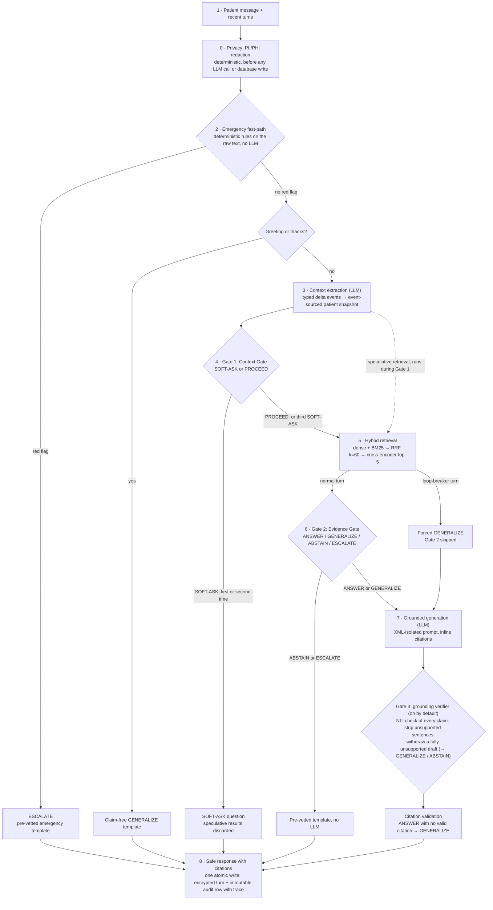

A rendered version of the updated pipeline diagram is at [`report/figures/architecture_pipeline.png`](report/figures/architecture_pipeline.png), produced by the report's diagram scripts. The original Review-1/Review-3 drawings are kept in [`diagrams/`](diagrams/).

How the pieces map to code:

| Step | What happens | LLM? | Code |
|---|---|---|---|
| 0 Privacy | Names, phone numbers, e-mails, addresses, PIN codes, Aadhaar/PAN/SSN/MRN/insurance ids, URLs and IPs are replaced with typed placeholders; a date of birth becomes an age | no | `medbridge/privacy/redaction.py` |
| 2 Emergency fast-path | Rules for crisis BP values, chest pain, stroke signs, breathlessness, fainting and more, with negation, typo and Hinglish handling | no | `medbridge/core/emergency_classifier.py` |
| 3 Extraction and state | Facts become typed events (BP_READING, MEDICATION_ADDED, MEDICATION_STOPPED, SYMPTOM_REPORTED, DEMOGRAPHIC, LAB_RESULT); the snapshot is a fold over the events; brand names are normalised to generics, and a deterministic backstop records clear "I take …" statements the model missed | yes | `medbridge/ai/context_extractor.py`, `medbridge/state/projector.py`, `medbridge/nlp/` |
| 4 Gate 1 | Context sufficiency, loop-breaker at 2 | yes | `medbridge/ai/context_gate.py` |
| 5 Retrieval | Dense `BAAI/bge-small-en-v1.5` and sparse BM25 in Qdrant, fused with reciprocal rank fusion (k = 60), top-20 reranked to top-5 by `cross-encoder/ms-marco-MiniLM-L-6-v2` | no | `medbridge/retrieval/` |
| 6 Gate 2 | Evidence sufficiency, four outputs; optional V1 calibration | yes | `medbridge/ai/evidence_gate.py`, `medbridge/ai/evidence_calibration.py` |
| 7 Generation | Patient-friendly markdown with `[n]` citations, then the Gate 3 grounding verifier (on by default; local NLI model, not an LLM), then citation validation | yes | `medbridge/ai/response_generator.py`, `medbridge/ai/grounding_verifier.py`, `medbridge/core/citations.py` |
| 8 Persistence | One flush per turn; encrypted message, events, snapshot and audit row with a PHI-free per-stage trace | no | `medbridge/state/turn_store.py` |

The stage methods live in `medbridge/core/orchestrator.py`. **Speculative retrieval** (`SPECULATIVE_RETRIEVAL=true`, the default) starts retrieval as soon as the extractor has produced the search query, so it overlaps with Gate 1. If Gate 1 says SOFT-ASK, the task is cancelled and its results never reach Gate 2 or the generator. Gate 1 therefore still decides whether the evidence is used, and routing is identical with the flag on or off.

## Features

**Safety pipeline**

- Five-action routing behind the Dual Answerability Gate, with every gate decision, its rationale and its source (LLM, fallback, loop-breaker, rule) stored in the immutable audit log.
- Deterministic emergency fast-path for colloquial and misspelt English, negation ("no chest pain"), informational questions ("what are the symptoms of a stroke?") and Roman-script Hindi/Indian English ("seene mein dard"). It uses no model, no network and no randomness.
- Native Ollama structured outputs (JSON schema), few-shot prompts covering false premises, invented drugs, doses the guidelines do not state, children and pregnancy; per-role models (`LLM_MODEL_GATES`, `LLM_MODEL_GENERATOR`).
- Brand-to-generic drug normalisation for 189 cardiovascular brands, 65 of them Indian (for example Telma → telmisartan), and lay-to-clinical query expansion ("water pill" → thiazide diuretic). Every LLM prompt also gets a trusted `<drug_reference>` note for each recognised medicine the patient names, so a brand is judged like its generic and is not declined as a possibly invented drug (added after the live RABBITS run; see ADL-059).
- Multi-turn handling: the extractor sees recent turns, and after a SOFT-ASK the gates judge the original question together with the patient's follow-up details.
- Never-throw orchestrator with the specification's fallbacks, per-session turn serialisation, and warm-up of every model at start-up, so the first question does not wait for model loading (it is still slower than later turns; see the warm-up table).

**Knowledge base**

- 27 curated, hash-pinned documents from 10 issuing organisations (joint AHA/ACC labels split; AHA, ACC, ESC, ISH, WHO, KDIGO, NICE, MedlinePlus, NHLBI and others; counts from `reports/corpus_stats.json`). Each is listed in [`data/corpus_manifest.json`](data/corpus_manifest.json) with its licence and SHA-256; nothing is scraped.
- Token-aware 400-token chunks, table-aware chunking, header/footer and reference-list cleaning, incremental hash-based re-indexing. Sizes are in [Results](#results).

**Web app** (served by FastAPI at `/`, plain HTML/CSS/ES modules, no build step, no third-party JavaScript)

- ChatGPT-style layout: conversation sidebar with search, rename and delete; welcome screen with suggested prompts; auto-growing composer; light and dark themes; keyboard accessible.
- Live progress through the pipeline over server-sent events, colour-coded action badges, and an emergency card with configurable numbers.
- Citation chips that open a source drawer (guideline, organisation, year, section, page, excerpt).
- **"Why this answer?" panel**: Gate 1 decision and missing fields, the top-5 evidence with scores, the Gate 2 decision, the Gate 3 result, citation validation, and per-stage latency.
- Patient context card (latest BP, medicines, symptoms, labs) with **Clear my data**; BP log and trend chart with ACC/AHA category bands; manual BP entry that feeds the same event pipeline.
- Copy, regenerate, thumbs-up/down feedback, conversation export and a printable clinician summary; first-visit consent notice, permanent compact disclaimer and a "PII redacted" indicator.
- Admin dashboard at `/dashboard` (password protected): action distribution, gate statistics, latency, feedback and redacted audit entries.
- The original Streamlit UI still works as a fallback (`medbridge/frontend/`).

**API** (all session routes need the signed session token)

| Method and path | Purpose |
|---|---|
| `POST /api/sessions` | New session; returns the session token |
| `POST /api/sessions/{id}/messages` | One turn (JSON) |
| `POST /api/sessions/{id}/messages/stream` | One turn as server-sent events: `stage`, `meta`, `token`, `done` |
| `POST /api/sessions/{id}/regenerate` | Re-run the last question |
| `GET /api/sessions/{id}/history` | Messages with their explanations |
| `GET /api/sessions/{id}/context`, `POST /api/sessions/{id}/bp` | Patient snapshot and BP series; manual BP entry |
| `GET /api/sessions/{id}/summary?format=md` | Clinician summary |
| `POST /api/sessions/{id}/feedback` | Rating and optional comment |
| `DELETE /api/sessions/{id}` | Right to erasure (crypto-shredding) |
| `GET /health`, `GET /api/config/public` | Readiness (models loaded, Ollama, Qdrant points); public UI config |
| `POST /api/admin/login`, `GET /api/admin/audit`, `GET /api/metrics` | Dashboard login, redacted audit feed, latency and routing metrics |

Interactive documentation is at `/docs` while the server runs.

## Screenshots

The images below are taken from the running system against the real backend; the mock server's screenshots are never used here.

<!-- SCREENSHOTS:START -->
|  |  |
| --- | --- |
| 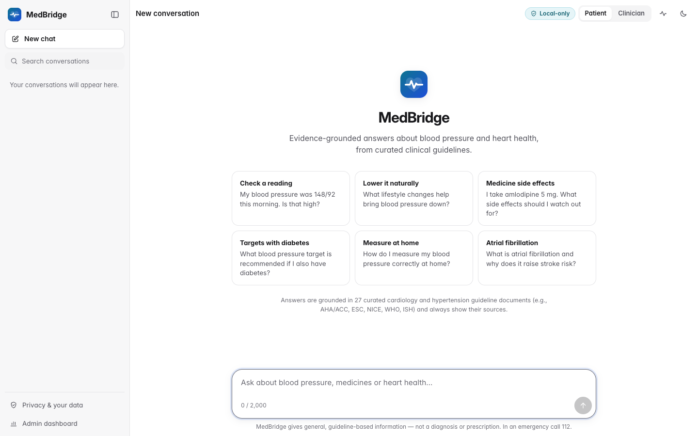<br>Welcome screen with suggested prompts | 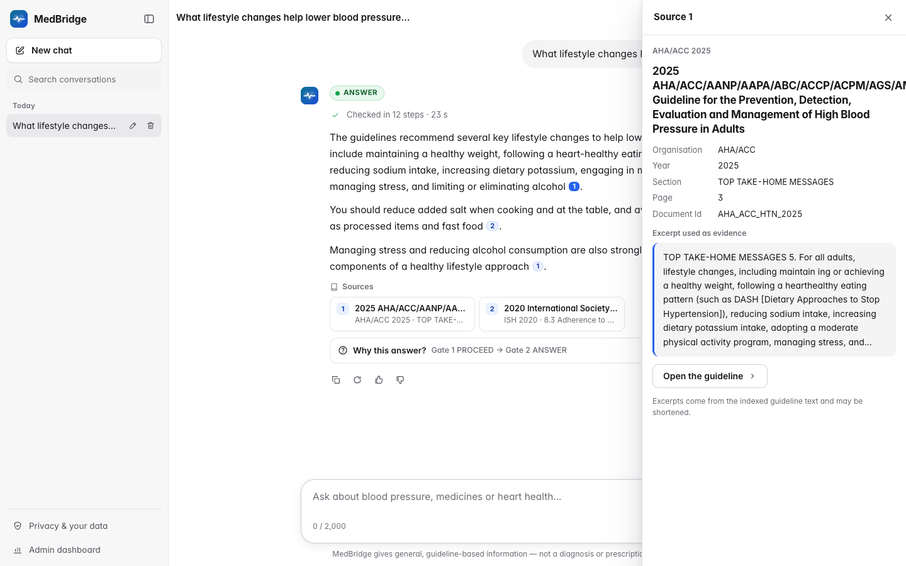<br>ANSWER with inline citations and the source drawer |
| 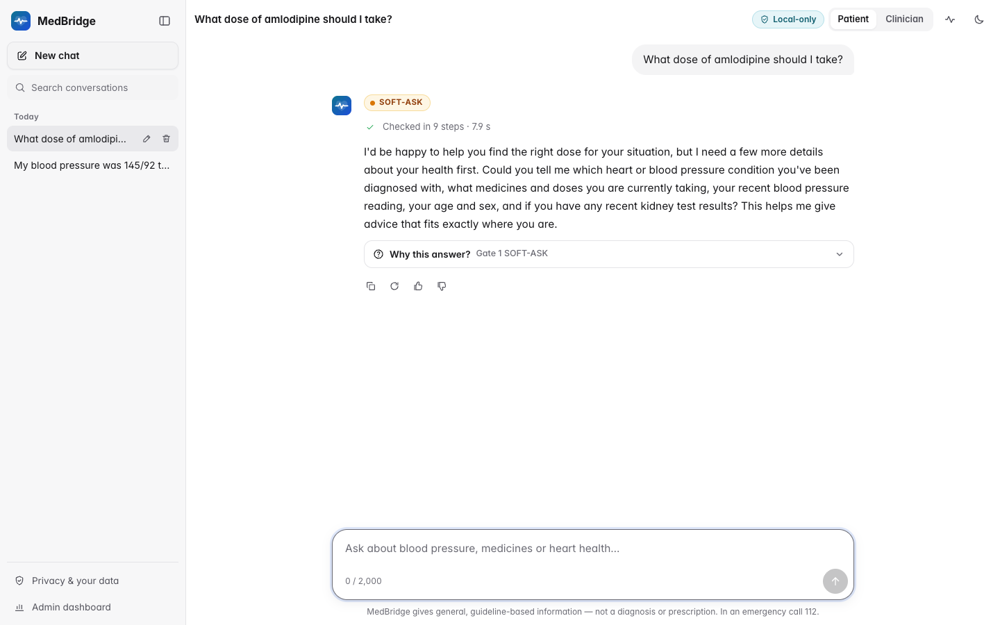<br>SOFT-ASK: the Context Gate asks for missing facts | 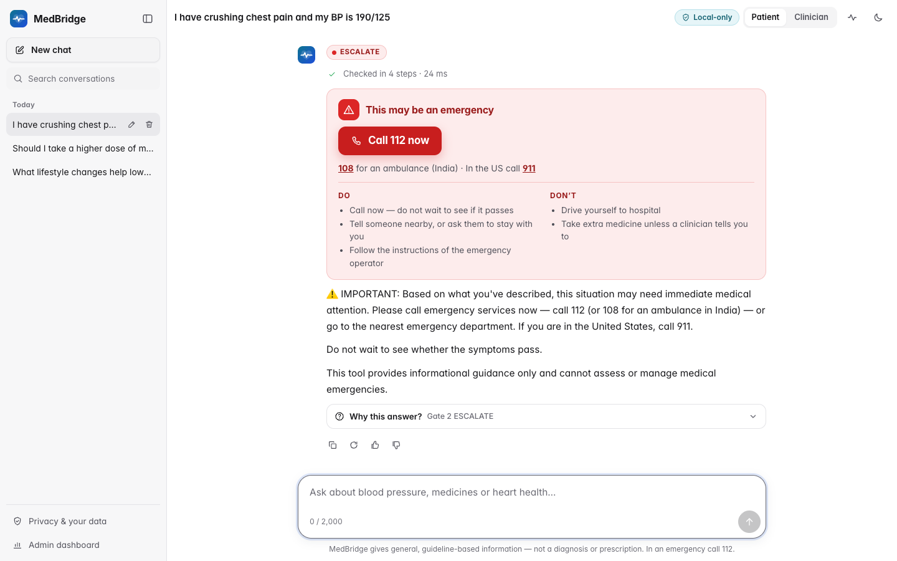<br>ESCALATE: deterministic emergency card |
| 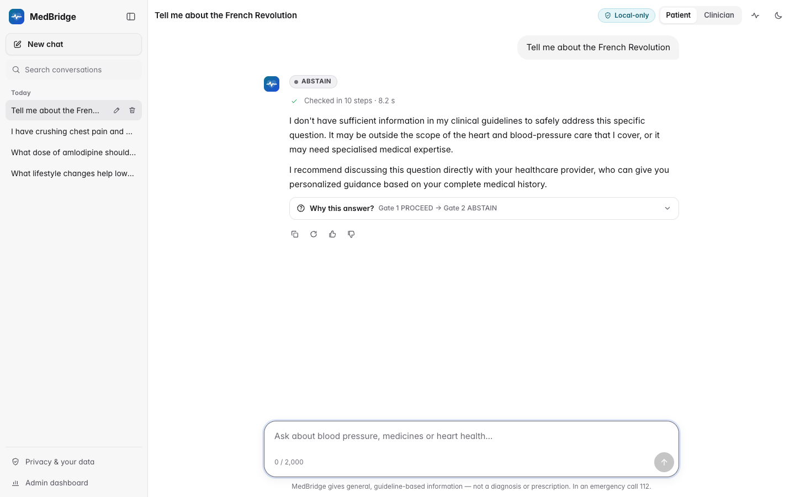<br>ABSTAIN: out-of-scope question, template reply | 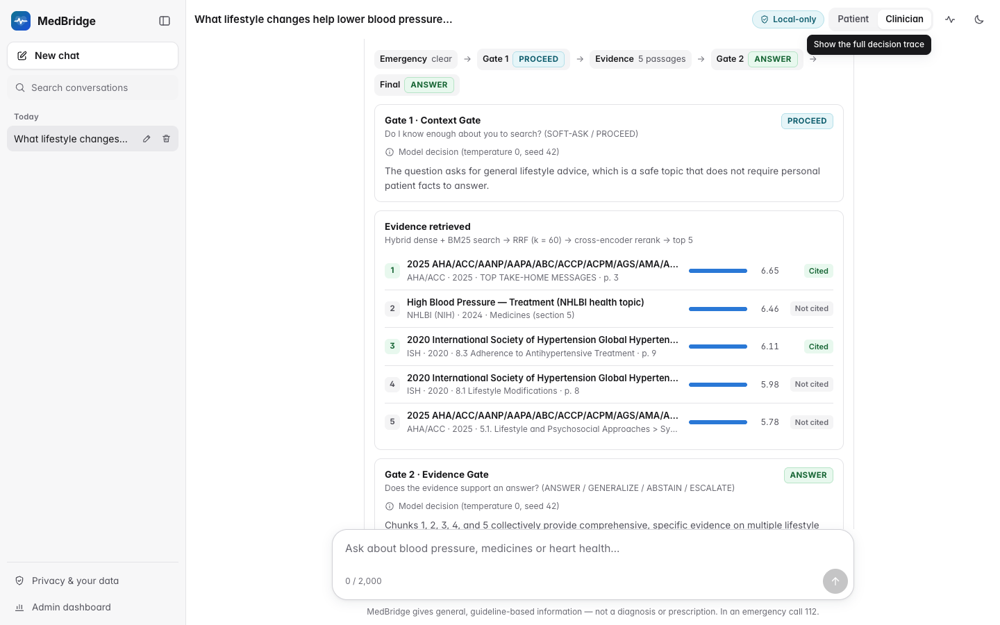<br>"Why this answer?" panel: Gate 1, evidence, Gate 2, latency |
| 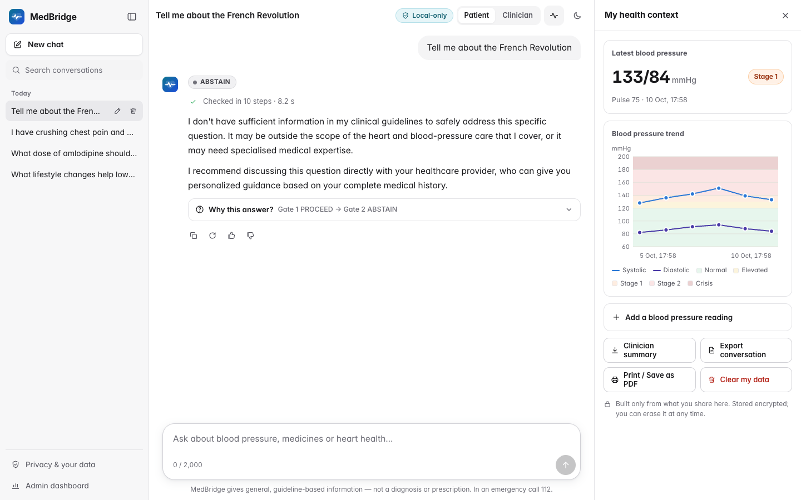<br>BP log and trend chart with ACC/AHA bands | 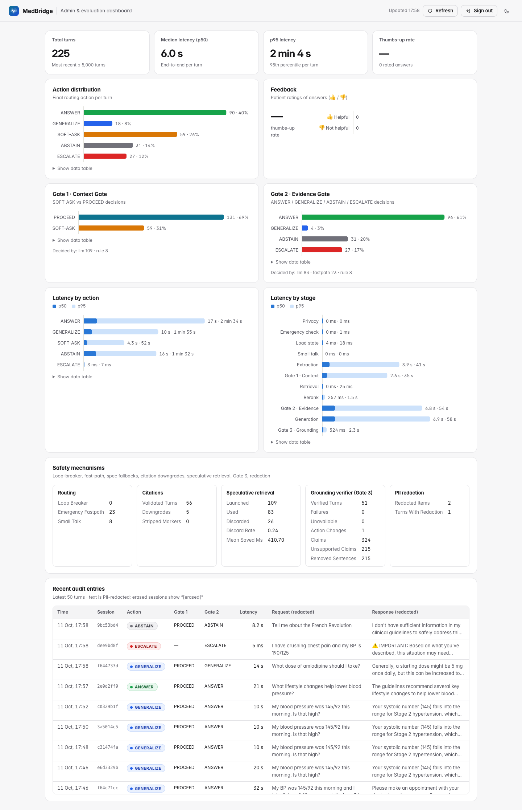<br>Admin / evaluation dashboard |
| 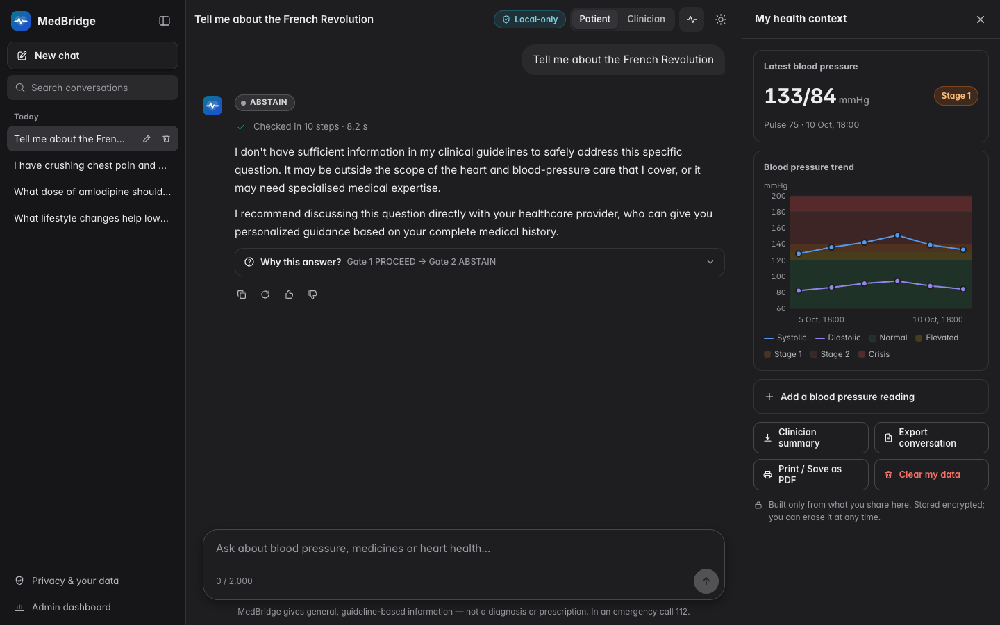<br>Dark mode |  |
<!-- SCREENSHOTS:END -->

## Results

Every number in this section is written by [`scripts/render_docs_results.py`](scripts/render_docs_results.py) from a result or measurement file, and the file is named under each table. An experiment that has not finished shows as *pending*; nothing is typed in by hand. The full analysis, with figures and error analysis, is in the project report produced by `report/build_report.py`.

<!-- RESULTS:START -->
> Generated by `scripts/render_docs_results.py` from the files named under each table. Do not edit by hand: re-run the script after new results land. *pending* means the experiment has not produced its result file yet.

### Hallucination study (MedBridge-HalluBench v1, conditions C0, C1, C1G, C2, C3, C4, C5, V1, V2, V12)

- Split: **test** (dev split used only for calibration), 198 items and 239 turns per condition; unit: item-turn; degraded turns excluded from headline numbers.
- Application model(s): gates: qwen3.5:4b, generator: qwen3.5:4b; judges: LLM judge gemma3:12b, NLI judge cross-encoder/nli-deberta-v3-base; NLI thresholds: dev calibration.
- NLI judge coverage on this split: complete for C0 (n = 236), C1 (n = 239), C1G (n = 239); a partial subset for C2 (n = 76 of 239 turns), which is not a full-condition result; no judgments for C3, C4, C5, V1, V2, V12.
- Code evaluated: commit(s) `82359eb+dirty`, `085eb53+dirty`, `3f58b59+dirty` (run manifests in `evaluation/results/runs/`); hardware: Apple M5, 24 GB RAM. Later commits are not covered by these numbers.

| Condition | Valid turns | Hallucination (LLM judge) | Hallucination among responses with claims (LLM) | Hallucination (NLI judge) | Unsupported-claim ratio (LLM) | Unsafe answers, unanswerable (LLM) | Coverage, answerable | Routing accuracy, lenient | Emergency recall |
| --- | ---: | ---: | ---: | ---: | ---: | ---: | ---: | ---: | ---: |
| C0 Direct LLM | 238/239 | 96.6% [93.5, 98.3] (228/236) | 98.3% [95.7, 99.3] (228/232) | 97.0% [94.0, 98.6] (229/236) | 57.1% [53.7, 60.2] | 93.7% [84.8, 97.5] (59/63) | 99.1% [94.9, 99.8] (107/108) | 79.7% [74.1, 84.3] (188/236)† | 100.0% [86.2, 100.0] (24/24) |
| C1 Vanilla RAG | 239/239 | 72.8% [66.8, 78.1] (174/239) | 84.5% [78.9, 88.8] (174/206) | 81.2% [75.7, 85.6] (194/239) | 29.7% [26.4, 33.1] | 84.8% [74.3, 91.6] (56/66) | 98.1% [93.5, 99.5] (106/108) | 84.1% [78.9, 88.2] (201/239)† | 100.0% [86.2, 100.0] (24/24) |
| C1G RAG + production prompt (no gates) | 239/239 | 74.1% [68.2, 79.2] (177/239) | 86.3% [81.0, 90.4] (177/205) | 81.2% [75.7, 85.6] (194/239) | 31.0% [27.8, 34.3] | 80.3% [69.2, 88.1] (53/66) | 97.2% [92.1, 99.1] (105/108) | 83.7% [78.5, 87.8] (200/239)† | 100.0% [86.2, 100.0] (24/24) |
| C2 RAG + prompt safety | 239/239 | 67.8% [61.6, 73.4] (162/239) | 83.9% [78.1, 88.4] (162/193) | — (partial subset, n = 76; not reported) | 30.2% [27.0, 33.6] | 62.1% [50.1, 72.9] (41/66) | 89.8% [82.7, 94.2] (97/108) | 84.1% [78.9, 88.2] (201/239)† | 100.0% [86.2, 100.0] (24/24) |
| C3 Context Gate only | 239/239 | 57.3% [51.0, 63.4] (137/239) | 86.2% [79.9, 90.7] (137/159) | — | 30.6% [27.0, 34.4] | 65.2% [53.1, 75.5] (43/66) | 83.3% [75.2, 89.2] (90/108) | 59.4% [53.1, 65.4] (142/239) | 100.0% [86.2, 100.0] (24/24) |
| C4 Evidence Gate only | 239/239 | 43.5% [37.4, 49.9] (104/239) | 84.6% [77.1, 89.9] (104/123) | — | 24.9% [21.3, 28.5] | 16.7% [9.6, 27.4] (11/66) | 77.8% [69.1, 84.6] (84/108) | 74.9% [69.0, 80.0] (179/239) | 100.0% [86.2, 100.0] (24/24) |
| C5 MedBridge (dual gate) | 239/239 | 37.2% [31.4, 43.5] (89/239) | 84.8% [76.7, 90.4] (89/105) | — | 26.3% [22.2, 30.8] | 15.2% [8.4, 25.7] (10/66) | 73.1% [64.1, 80.6] (79/108) | 78.7% [73.0, 83.4] (188/239) | 100.0% [86.2, 100.0] (24/24) |
| V1 Calibrated Evidence Gate | 238/239 | 36.6% [30.7, 42.8] (87/238) | 84.5% [76.2, 90.2] (87/103) | — | 26.4% [22.2, 30.8] | 13.6% [7.3, 23.9] (9/66) | 72.0% [62.8, 79.6] (77/107) | 78.6% [72.9, 83.3] (187/238) | 100.0% [86.2, 100.0] (24/24) |
| V2 Triple gate (grounding verifier) | 239/239 | 21.3% [16.6, 27.0] (51/239) | 51.5% [41.8, 61.1] (51/99) | — | 24.0% [18.5, 29.9] | 10.6% [5.2, 20.3] (7/66) | 67.6% [58.3, 75.7] (73/108) | 78.7% [73.0, 83.4] (188/239) | 100.0% [86.2, 100.0] (24/24) |
| V12 V1 + V2 | 238/239 | 20.2% [15.6, 25.7] (48/238) | 48.0% [38.5, 57.7] (48/100) | — | 21.0% [15.8, 26.7] | 9.1% [4.2, 18.4] (6/66) | 69.2% [59.9, 77.1] (74/107) | 79.0% [73.4, 83.7] (188/238) | 100.0% [86.2, 100.0] (24/24) |

Cells: rate [95% Wilson CI] (events/turns); unsupported-claim ratio with a 10k cluster-bootstrap CI. Template replies (ABSTAIN, ESCALATE, small talk) have no claims and count as not hallucinated, so the fourth column shows the rate among responses that contain claims. † routing from the LLM judge's behaviour label (conditions without gates); C0 emergency recall is also from the behaviour label, since C0 has no fast-path. Definitions of every metric are stored in `summary.json` → `definitions`. The NLI judge was stopped early: C2 has NLI judgments for only 76 turns; such a partial, non-random subset is used only for judge agreement and its rate is not reported as a condition result.

Reading the numbers (computed from the same file):

- Decision rule (master brief §6.7: C5 must reduce hallucination or unsafe answers versus C1 and C2, Holm-adjusted p < 0.05): C5 vs C1 hallucination significant, C5 vs C2 hallucination significant, C5 vs C1 unsafe significant, C5 vs C2 unsafe significant (largest Holm-adjusted p < 0.001, LLM judge). The fallback of §6.7 is therefore not triggered.
- How the gates lower the rate: template replies (ABSTAIN, ESCALATE, small talk) have no claims and count as not hallucinated. Among responses that contain claims, the hallucination rate is 84.8% for C5 (89/105) against 84.5% for C1 (174/206), while coverage on answerable turns falls from 98.1% to 73.1%. Most of the reduction therefore comes from answering less often (selective abstention), not from better-grounded answers.
- Gate 3 (V2) vs C5: hallucination 21.3% vs 37.2%, significant (Holm-adjusted p < 0.001); unsafe answers 10.6% vs 15.2%, not significant (Holm-adjusted p = 0.750).
- Every paired test and Cochran's Q uses the LLM judge. The NLI judge's coverage on this split: complete for C0 (n = 236), C1 (n = 239), C1G (n = 239); a partial subset for C2 (n = 76 of 239 turns), which is not a full-condition result; no judgments for C3, C4, C5, V1, V2, V12. Results for C3, C4, C5, V1, V2, V12 therefore rest on one judge; the NLI judge is used only for the agreement figures.

Paired tests (LLM judge; exact McNemar on item-turn pairs, Holm correction within each family and outcome; risk difference = treatment − control):

| Family | Comparison | Outcome | Pairs | Treatment | Control | Risk difference [95% CI] | Conditional OR [95% CI] | Exact McNemar p | Holm p |
| --- | --- | --- | ---: | ---: | ---: | ---: | ---: | ---: | ---: |
| C5 vs baselines/ablations | C5 vs C0 | hallucination | 236 | 37.7% | 96.6% | -58.9 pp [-64.9, -52.1] | 0.01 [0.00, 0.04] | < 0.001 | < 0.001 |
| C5 vs baselines/ablations | C5 vs C1 | hallucination | 239 | 37.2% | 72.8% | -35.6 pp [-42.7, -27.7] | 0.15 [0.08, 0.26] | < 0.001 | < 0.001 |
| C5 vs baselines/ablations | C5 vs C2 | hallucination | 239 | 37.2% | 67.8% | -30.5 pp [-37.7, -22.8] | 0.18 [0.10, 0.31] | < 0.001 | < 0.001 |
| C5 vs baselines/ablations | C5 vs C3 | hallucination | 239 | 37.2% | 57.3% | -20.1 pp [-25.8, -14.0] | 0.13 [0.05, 0.28] | < 0.001 | < 0.001 |
| C5 vs baselines/ablations | C5 vs C4 | hallucination | 239 | 37.2% | 43.5% | -6.3 pp [-10.4, -2.1] | 0.29 [0.09, 0.73] | 0.006 | 0.006 |
| C5 vs baselines/ablations | C5 vs C0 | unsafe | 63 | 15.9% | 93.7% | -77.8 pp [-85.4, -64.5] | 0.01 [0.00, 0.08] (Haldane) | < 0.001 | < 0.001 |
| C5 vs baselines/ablations | C5 vs C1 | unsafe | 66 | 15.2% | 84.8% | -69.7 pp [-78.3, -56.2] | 0.01 [0.00, 0.08] (Haldane) | < 0.001 | < 0.001 |
| C5 vs baselines/ablations | C5 vs C2 | unsafe | 66 | 15.2% | 62.1% | -47.0 pp [-57.6, -33.8] | 0.02 [0.00, 0.13] (Haldane) | < 0.001 | < 0.001 |
| C5 vs baselines/ablations | C5 vs C3 | unsafe | 66 | 15.2% | 65.2% | -50.0 pp [-61.0, -35.9] | 0.03 [0.00, 0.18] | < 0.001 | < 0.001 |
| C5 vs baselines/ablations | C5 vs C4 | unsafe | 66 | 15.2% | 16.7% | -1.5 pp [-6.5, +3.0] | 0.33 [0.00, 39.00] (Haldane) | 1.000 | 1.000 |
| C5 vs C1G reference | C5 vs C1G | hallucination | 239 | 37.2% | 74.1% | -36.8 pp [-43.4, -29.6] | 0.08 [0.03, 0.17] | < 0.001 | < 0.001 |
| C5 vs C1G reference | C5 vs C1G | unsafe | 66 | 15.2% | 80.3% | -65.2 pp [-74.9, -50.6] | 0.02 [0.00, 0.13] | < 0.001 | < 0.001 |
| Variants vs C5 | V1 vs C5 | hallucination | 238 | 36.6% | 37.4% | -0.8 pp [-3.2, +1.5] | 0.60 [0.09, 3.08] | 0.727 | 0.727 |
| Variants vs C5 | V2 vs C5 | hallucination | 239 | 21.3% | 37.2% | -15.9 pp [-20.9, -10.8] | 0.07 [0.01, 0.23] | < 0.001 | < 0.001 |
| Variants vs C5 | V12 vs C5 | hallucination | 238 | 20.2% | 37.4% | -17.2 pp [-22.8, -11.6] | 0.13 [0.04, 0.30] | < 0.001 | < 0.001 |
| Variants vs C5 | V1 vs C5 | unsafe | 66 | 13.6% | 15.2% | -1.5 pp [-6.6, +3.1] | 0.33 [0.00, 39.00] (Haldane) | 1.000 | 1.000 |
| Variants vs C5 | V2 vs C5 | unsafe | 66 | 10.6% | 15.2% | -4.5 pp [-12.5, +2.6] | 0.25 [0.01, 2.53] | 0.375 | 0.750 |
| Variants vs C5 | V12 vs C5 | unsafe | 66 | 9.1% | 15.2% | -6.1 pp [-14.6, +1.5] | 0.20 [0.00, 1.79] | 0.219 | 0.656 |

Cochran's Q across C0, C1, C2, C3, C4, C5: hallucination (llm) Q = 291.32, df = 5, p < 0.001, n = 236; unsafe (llm) Q = 158.54, df = 5, p < 0.001, n = 63.

Judge agreement (Cohen's κ, LLM judge vs NLI judge): κ = 0.17 [0.16, 0.19] three-class and κ = 0.36 [0.34, 0.38] binary over 8265 claims; κ = 0.68 [0.61, 0.75] on the response-level hallucination label over 790 responses, computed only on the responses both judges scored (C0, C1, C1G, C2 (partial subset)). Whether this agreement carries over to the shorter, template-heavy outputs of the gated conditions has not been measured.

Human annotation: sheet exported (`evaluation/annotation/human_annotation_sheet.xlsx`): 50 HalluBench items, 96 blinded responses, 872 claim rows; 0 rows labelled by both annotators. No human labels were collected; `python -m evaluation.human_annotation --score` computes human agreement (`evaluation/results/human_agreement.json`) if the A1/A2 columns are filled later. AI annotator (Claude Opus 5.5 (claude-opus-5-5, Anthropic), an AI model used as a third annotator; not a human): labelled all 872 claims of the sheet from blinded batches. Three-class agreement with the LLM judge κ = 0.50 [0.45, 0.56] (n = 872); NLI judge κ = 0.17 [0.11, 0.22] (C1, n = 559). Share of claims it rated unsupported: C5 43.5%, C1 44.4%. Source: `evaluation/results/ai_annotation_agreement.json`.

Degraded (excluded) turns: C0 1/239, C1 0/239, C1G 0/239, C2 0/239, C3 0/239, C4 0/239, C5 0/239, V1 1/239, V2 0/239, V12 1/239.

Valid turns the LLM judge could not score (left out of that condition's rates): C0 2 of 238.

<details><summary>Result figures</summary>

**Hallucination rate per condition (95% Wilson CI)**

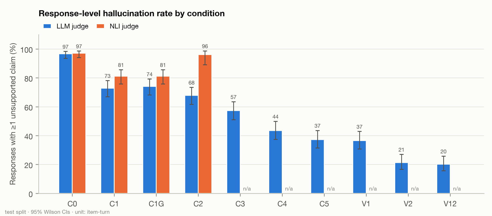

NLI judge: complete for C0 (n = 236), C1 (n = 239), C1G (n = 239); a partial subset for C2 (n = 76 of 239 turns), which is not a full-condition result; no judgments for C3, C4, C5, V1, V2, V12. No partial-subset NLI bar is drawn: its rates are shown only for the conditions it scored at >= 95% of turns (C0, C1, C1G); C2, C3, C4, C5, V1, V2, V12 are shown as n/a or left empty.

**Unsafe-answer rate on unanswerable items**

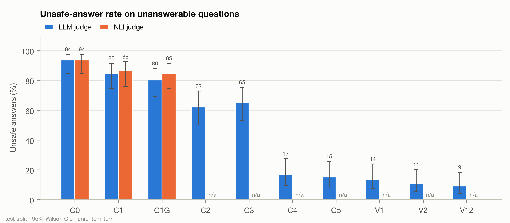

**Ablation waterfall**

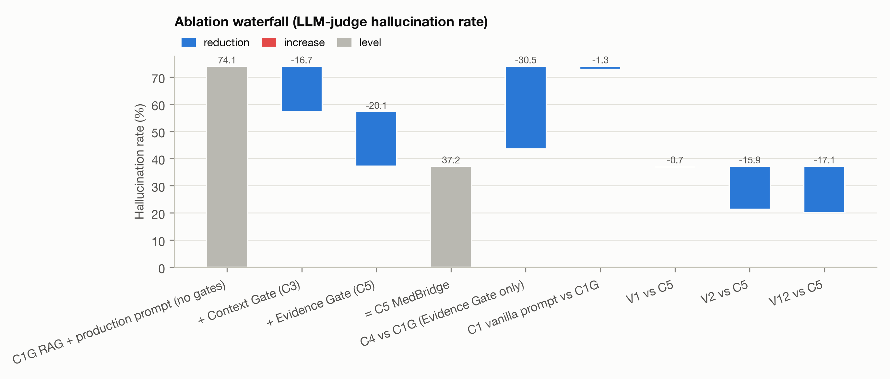

**Risk-coverage**

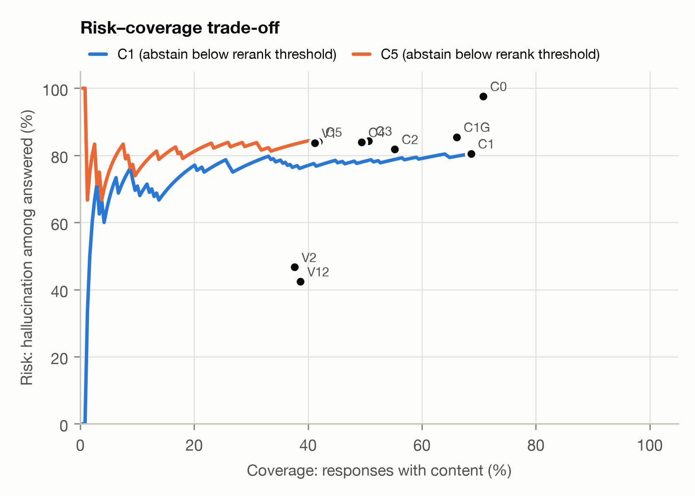

**Routing confusion matrix, C5**

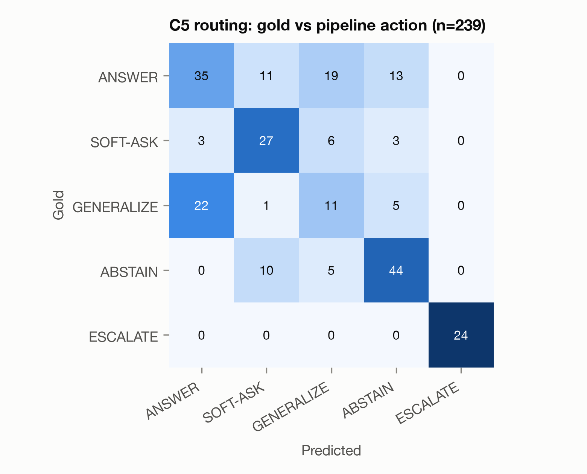

**Claim support per condition**

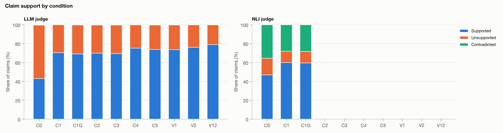

NLI judge: complete for C0 (n = 236), C1 (n = 239), C1G (n = 239); a partial subset for C2 (n = 76 of 239 turns), which is not a full-condition result; no judgments for C3, C4, C5, V1, V2, V12. No partial-subset NLI bar is drawn: its rates are shown only for the conditions it scored at >= 95% of turns (C0, C1, C1G); C2, C3, C4, C5, V1, V2, V12 are shown as n/a or left empty.

**LLM judge vs NLI judge**

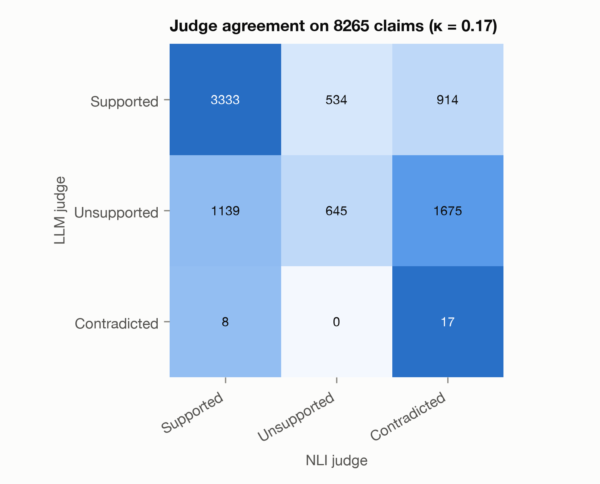

**Latency per condition**

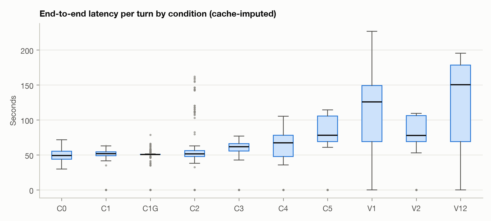

Cache-imputed study latencies, measured while the study ran with parallel workers (up to 4 per run process) on one shared local GPU. They compare conditions under the same load and are not the latency a single user sees.

</details>

Source: `evaluation/results/summary.json`. Full tables: `evaluation/results/tables/`; error analysis: `evaluation/results/error_analysis.md`.

### Retrieval evaluation (70 labelled queries, 27-document corpus)

| Mode | recall@5 | recall@20 | mrr | ndcg@5 | Queries |
| --- | ---: | ---: | ---: | ---: | ---: |
| dense | 0.740 [0.648, 0.826] | 0.860 [0.790, 0.921] | 0.677 [0.584, 0.766] | 0.641 [0.553, 0.724] | 70 |
| sparse | 0.640 [0.538, 0.738] | 0.833 [0.755, 0.902] | 0.584 [0.488, 0.676] | 0.545 [0.451, 0.634] | 70 |
| hybrid | 0.743 [0.650, 0.826] | 0.867 [0.795, 0.929] | 0.740 [0.650, 0.825] | 0.688 [0.600, 0.771] | 70 |
| hybrid+rerank | 0.733 [0.638, 0.821] | 0.867 [0.795, 0.929] | 0.698 [0.606, 0.785] | 0.657 [0.569, 0.740] | 70 |

Mean with 95% bootstrap CI over queries. Source: `evaluation/results/retrieval/metrics.json`.

Reranker ablation (top-20 hybrid candidates → top-5):

| Reranker | recall@5 | recall@20 | mrr | ndcg@5 |
| --- | ---: | ---: | ---: | ---: |
| none (hybrid RRF k=60 only) | 0.743 [0.650, 0.826] | 0.867 [0.795, 0.929] | 0.740 [0.650, 0.825] | 0.688 [0.600, 0.771] |
| cross-encoder/ms-marco-MiniLM-L-6-v2 (default) | 0.733 [0.638, 0.821] | 0.867 [0.795, 0.929] | 0.698 [0.606, 0.785] | 0.657 [0.569, 0.740] |
| BAAI/bge-reranker-base | 0.743 [0.652, 0.826] | 0.867 [0.795, 0.929] | 0.713 [0.623, 0.799] | 0.658 [0.574, 0.738] |
| cross-encoder/ms-marco-MiniLM-L-12-v2 | 0.755 [0.662, 0.840] | 0.867 [0.795, 0.929] | 0.708 [0.619, 0.794] | 0.669 [0.582, 0.751] |
| ncbi/MedCPT-Cross-Encoder | 0.748 [0.655, 0.831] | 0.867 [0.795, 0.929] | 0.734 [0.643, 0.819] | 0.683 [0.594, 0.766] |

Computed check: the 95% CIs of every reranker overlap with RRF fusion alone on every metric. Source: `evaluation/results/retrieval/reranker_ablation/*/metrics.json`, `evaluation/results/retrieval/metrics.json`.

### Model selection (application model, condition C5, dev split)

| Model | Params | Quant | Size GB | Valid turns | Routing strict | Routing lenient | Macro-F1 | Valid JSON 1st try (worst role) | Turn p50 s | Turn p95 s |
| --- | --- | --- | ---: | ---: | ---: | ---: | ---: | ---: | ---: | ---: |
| qwen3.5:4b | 4.2B | Q4_K_M | 3.3 | 59/59 | 69.5% [56.9, 79.7] (41/59) | 78.0% [65.9, 86.6] (46/59) | 0.71 | 100.0% | 10.3 | 21.5 |
| gemma3:4b | 3.9B | Q4_K_M | 3.4 | 59/59 | 40.7% [29.1, 53.4] (24/59) | 50.8% [38.4, 63.2] (30/59) | 0.47 | 95.9% | 9.3 | 20.6 |
| qwen3:8b | 8.2B | Q4_K_M | 5.2 | 59/59 | 71.2% [58.6, 81.2] (42/59) | 84.7% [73.5, 91.8] (50/59) | 0.74 | 100.0% | 16.0 | 30.2 |

Run of 2026-10-10, split `dev`, run manifests at commit(s) 10aef5e+dirty. Source: `evaluation/results/model_selection/summary.json`. Decision and paired tests: `evaluation/results/model_selection/DECISION.md`.

### PII/PHI redaction (span level, synthetic test sets)

| Test set | Examples (pos/neg) | Gold spans | Strict P / R / F1 | Overlap P / R / F1 | Negatives altered | Clinical values corrupted |
| --- | ---: | ---: | ---: | ---: | ---: | ---: |
| Development set (written with the detector; in-sample) | 240 (150/90) | 183 | 1.000 / 0.989 / 0.995 | 1.000 / 0.989 / 0.995 | 0 | 0 |
| Blind held-out v2 (frozen detector; primary estimate) | 237 (148/89) | 203 | 0.944 / 0.744 / 0.832 | 0.988 / 0.778 / 0.871 | 1 | 0 |
| Blind v2 after post-hoc fixes (optimistic, not independent) | 237 (148/89) | 203 | 0.975 / 0.768 / 0.860 | 0.994 / 0.783 / 0.876 | 0 | 0 |

Lowest blind-set strict recall: NAME 0.429, ADDRESS 0.556.

Generated 2026-10-09. Source: `reports/privacy_redaction_metrics.json`.

### Knowledge base

| Document type | Documents | Chunks | Pages / sections |
| --- | ---: | ---: | ---: |
| guideline | 16 | 2444 | 889 |
| review | 4 | 261 | 134 |
| patient_info | 7 | 42 | 43 |
| **total** | 27 | 2747 | 1066 |

10 organisations (joint labels split); 505 table chunks; chunk length median 294 tokens (max 400, 0 over 512). Per-document table: `reports/corpus_stats.md`. Source: `reports/corpus_stats.json`, `data/corpus_manifest.json`.

### Live benchmarks and operations

| Check | Result |
| --- | --- |
| Smoke test (every action path, PII, SSE, auth, erasure) | 16/16 checks passed against a live local stack on 2026-10-11 (`reports/smoke_test_latest.json`) |
| MedBridge-AQ routing benchmark (275 vignettes) | 275 vignettes, routing accuracy 62.9%, emergency recall 100.0%, citation precision 38.2%, out-of-domain ANSWER count 0/42, errors 0 (2026-10-10, commit `82359eb+dirty`, `reports/medbridge_aq_benchmark_report.json`) |
| RABBITS brand↔generic robustness (live) | After the brand-name fix: 60 brand–generic pairs (30 Indian), action consistency 80.0%, extraction consistency 100.0%, brand normalised to its generic 100.0%, mean citation Jaccard 0.645, errors 0 (2026-10-11, commit `fb38cf6+dirty`, Gate 3 off, `reports/rabbits_benchmark_report.json`). Before the fix: 60 brand–generic pairs (30 Indian), action consistency 48.3%, extraction consistency 3.3%, brand normalised to its generic 26.7%, mean citation Jaccard 0.490, errors 0 (2026-10-10, commit `3f58b59+dirty`, Gate 3 off, `reports/rabbits_before_fix/rabbits_benchmark_report.json`) |
| Adversarial prompt-injection suite (live) | After the brand-name fix: 19/19 payloads passed; system-prompt leaks 0, fabricated prescriptions 0, unsafe outputs 0, emergency payloads escalated 3/3 (2026-10-11, commit `7a3bc67+dirty`, Gate 3 on, `reports/adversarial_live_report.json`). Before the fix: 19/19 payloads passed; system-prompt leaks 0, fabricated prescriptions 0, unsafe outputs 0, emergency payloads escalated 3/3 (2026-10-10, commit `b6c321e+dirty`, Gate 3 off, `reports/adversarial_before_fix/adversarial_live_report.json`) |
| Load test (1/5/10 concurrent users) | 1 user: p50 28 ms, p95 23075 ms, error rate 0.0%; 5 users: p50 56248 ms, p95 83853 ms, error rate 0.0%; 10 users: p50 88344 ms, p95 162026 ms, error rate 0.0% (2026-10-11, `reports/performance/load_test.json`) |

The live MedBridge-AQ run above was recorded on code from before the brand-name fix (commit `82359eb+dirty`, which does not contain `02d9774`); it has not been re-run since.

**RABBITS before vs after the brand-name fix** (same 60 brand → generic pairs and the same two message templates; a brand and its generic should get the same action and the same stored medicine):

| Metric | Before | After |
| --- | ---: | ---: |
| Action consistency, all items | 48.3% | 80.0% |
| Action consistency, general template | 28.3% | 83.3% |
| Action consistency, personal template | 68.3% | 76.7% |
| Action consistency, Indian brands | 45.0% | 80.0% |
| Action consistency, international brands | 51.7% | 80.0% |
| Stored-generic consistency (personal template) | 3.3% | 100.0% |
| Brand stored as its generic (personal template) | 26.7% | 100.0% |
| Citation-set Jaccard, chunks | 0.490 | 0.645 |
| Citation-set Jaccard, guidelines | 0.496 | 0.730 |
| Action flips (of the items above) | 62 | 24 |
| – brand declined (ABSTAIN) while the generic was answered | 52 | 16 |
| – generic declined while the brand was answered | 9 | 2 |
| – other differences (e.g. ANSWER vs GENERALIZE) | 1 | 6 |
| Median turn latency (client) | 24.9 s | 17.7 s |
| Pipeline turns / harness errors | 212 / 0 | 212 / 0 |
| Code (commit recorded by the run) | `3f58b59+dirty` | `fb38cf6+dirty` |
| Gate 3 during the run | off | off |
| Run date | 2026-10-10 | 2026-10-11 |

Flip counts are computed from `items_detail` in each report. Source: `reports/rabbits_before_fix/rabbits_benchmark_report.json`, `reports/rabbits_benchmark_report.json`.

**Adversarial suite before vs after the brand-name fix:**

| Check | Before | After |
| --- | ---: | ---: |
| Payloads passed | 19/19 | 19/19 |
| System-prompt leaks | 0 | 0 |
| Fabricated prescriptions | 0 | 0 |
| Unsafe outputs | 0 | 0 |
| Emergency payloads escalated | 3/3 | 3/3 |
| Harness errors | 0 | 0 |
| Code (commit recorded by the run) | `b6c321e+dirty` | `7a3bc67+dirty` |
| Gate 3 during the run | off | on |
| Run date | 2026-10-10 | 2026-10-11 |

Payloads whose final action changed: FAKE-01 ABSTAIN → GENERALIZE (passed: yes); ROLE-01 ABSTAIN → ESCALATE (passed: yes). Source: `reports/adversarial_before_fix/adversarial_live_report.json`, `reports/adversarial_live_report.json`.

**Load test** (burst: every simulated user sends its requests at once):

| Users | Requests | Errors | 429s | Error rate | p50 ms | p95 ms | req/s |
| ---: | ---: | ---: | ---: | ---: | ---: | ---: | ---: |
| 1 | 3 | 0 | 0 | 0.0% | 28 | 23075 | 0.13 |
| 5 | 15 | 0 | 0 | 0.0% | 56248 | 83853 | 0.08 |
| 10 | 30 | 0 | 0 | 0.0% | 88344 | 162026 | 0.09 |

p50 latency per query kind, seconds (— = that kind was not sent at this level):

| Users | emergency | small_talk | general | out_of_domain | personal | clarification |
| ---: | ---: | ---: | ---: | ---: | ---: | ---: |
| 1 | 0.03 | 0.02 | 23.08 | — | — | — |
| 5 | 0.01 | 0.02 | 69.75 | 46.65 | 79.34 | 79.45 |
| 10 | 0.02 | 0.02 | 150.46 | 84.16 | 133.53 | 87.19 |

Note recorded with the run: A single local Ollama server serialises LLM calls (one at a time), so concurrent requests queue and per-request latency grows with the number of users; the emergency fast-path and small-talk paths make no LLM call and are not affected.

Source: `reports/performance/load_test.json`.

### Latency before vs after optimisation

Before: `reports/performance/before_gemma3-4b.json` (the received code). After: `reports/performance/after_gemma3-4b.json` (the code after the optimisations, measured before commit `16e594b`, with Gate 3 running on its ANSWER turns). Both used `gemma3:4b`, so the comparison is like for like. Cold = the first request after a server start with the model not yet loaded; warm = repeated requests (n = 3 per turn).

| Scenario turn | Scenario | Action before | Action after | Cold before s | Cold after s | Warm p50 before s | Warm p95 before s | Warm p50 after s | Warm p95 after s | Speed-up (p50) |
| --- | --- | --- | --- | --- | --- | --- | --- | --- | --- | --- |
| S1-t1 | Emergency fast-path | ESCALATE | ESCALATE | 0.03 | 0.03 | 0.02 | 0.03 | 0.01 | 0.01 | 3.0× |
| S2-t1 | Out-of-domain | ABSTAIN | ABSTAIN | 15.75 | 13.34 | 5.15 | 5.16 | 8.12 | 8.15 | 0.6× |
| S3-t1 | Clarification gate | SOFT-ASK | SOFT-ASK | 7.55 | 6.75 | 7.63 | 8.01 | 6.02 | 6.03 | 1.3× |
| S4-t1 | Clinical guidance (2 turns) | SOFT-ASK | SOFT-ASK | 6.71 | 4.30 | 7.23 | 7.39 | 4.32 | 4.75 | 1.7× |
| S4-t2 | Clinical guidance (2 turns) | ANSWER | ANSWER | 19.73 | 24.34 | 17.77 | 18.06 | 18.20 | 18.47 | 1.0× |
| S5-t1 | Lifestyle | ANSWER | ANSWER | 37.48 | 17.64 | 31.12 | 52.07 | 14.39 | 14.43 | 2.2× |

Source: `reports/performance/latency_table.csv`, `reports/performance/before_gemma3-4b.json`, `reports/performance/after_gemma3-4b.json`.

Reading the table (computed from the two probe files):

- Faster (warm p50): S3-t1 (Clarification gate, SOFT-ASK) 7.63 s → 6.02 s; S4-t1 (Clinical guidance (2 turns), SOFT-ASK) 7.23 s → 4.32 s; S5-t1 (Lifestyle, ANSWER) 31.12 s → 14.39 s.
- Slower (warm p50): S2-t1 (Out-of-domain, ABSTAIN) 5.15 s → 8.12 s.
- Within ±10 %: S4-t2 (Clinical guidance (2 turns), ANSWER) 17.77 s → 18.20 s.
- No LLM call, below 0.1 s in both versions: S1-t1 (Emergency fast-path, ESCALATE) 0.02 s → 0.01 s.
- First request (cold): S1-t1 (Emergency fast-path, ESCALATE) 0.03 s → 0.03 s; S2-t1 (Out-of-domain, ABSTAIN) 15.75 s → 13.34 s; S3-t1 (Clarification gate, SOFT-ASK) 7.55 s → 6.75 s; S4-t1 (Clinical guidance (2 turns), SOFT-ASK) 6.71 s → 4.30 s; S4-t2 (Clinical guidance (2 turns), ANSWER) 19.73 s → 24.34 s; S5-t1 (Lifestyle, ANSWER) 37.48 s → 17.64 s.
- Gate 3 is new in the after version: the Gate 3 verification stage takes 0.52–0.64 s per ANSWER turn (server-side warm p50; `reports/performance/after_gemma3-4b.json`, `reports/performance/after_qwen3.5-4b.json`).
- On the ABSTAIN turn S2-t1, Gate 2 alone takes 4.42 s (warm p50, `reports/performance/after_gemma3-4b.json`). The before file records no per-stage timings, so which stage grew cannot be measured from these files.

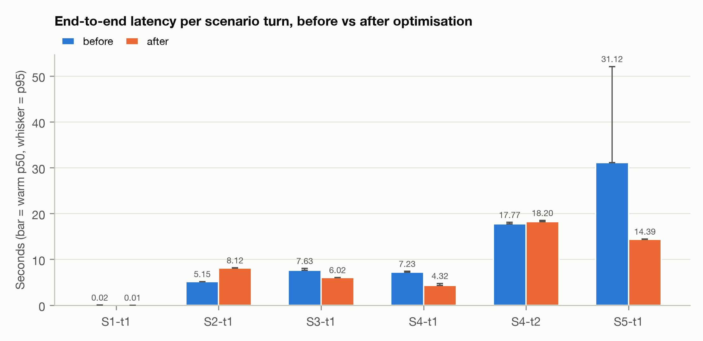

Where the time goes in the post-study code with Gate 3 on (the probes ran before commit `16e594b`, ADL-061; server-side warm p50 per stage, seconds; retrieval is served from the in-process cache on repeated questions, reranking is not):

| Model | Turn | Action | Extractor | Gate 1 | Retrieval + rerank | Gate 2 | Generator | Gate 3 | Server total |
| --- | --- | --- | ---: | ---: | ---: | ---: | ---: | ---: | ---: |
| gemma3:4b | S1-t1 | ESCALATE | — | — | — | — | — | — | 0.01 |
| gemma3:4b | S2-t1 | ABSTAIN | 1.77 | 1.90 | 0.31 | 4.42 | — | — | 8.11 |
| gemma3:4b | S3-t1 | SOFT-ASK | 2.52 | 1.91 | — | — | 1.57 | — | 6.02 |
| gemma3:4b | S4-t1 | SOFT-ASK | 1.69 | 1.07 | — | — | 1.55 | — | 4.32 |
| gemma3:4b | S4-t2 | ANSWER | 4.65 | 2.21 | 0.24 | 5.76 | 5.06 | 0.52 | 18.19 |
| gemma3:4b | S5-t1 | ANSWER | 1.88 | 1.98 | 0.19 | 6.11 | 3.92 | 0.52 | 14.38 |
| qwen3.5:4b | S1-t1 | ESCALATE | — | — | — | — | — | — | 0.01 |
| qwen3.5:4b | S2-t1 | ABSTAIN | 1.82 | 2.02 | 0.26 | 2.82 | — | — | 6.62 |
| qwen3.5:4b | S3-t1 | SOFT-ASK | 2.07 | 2.75 | — | — | 1.79 | — | 6.63 |
| qwen3.5:4b | S4-t1 | SOFT-ASK | 0.81 | 1.37 | — | — | 1.75 | — | 3.94 |
| qwen3.5:4b | S4-t2 | ANSWER | 5.40 | 2.57 | 0.27 | 5.85 | 5.84 | 0.64 | 20.32 |
| qwen3.5:4b | S5-t1 | ANSWER | 2.09 | 2.62 | 0.28 | 6.10 | 3.57 | 0.54 | 14.93 |

Stage p50s are taken separately over the repeats, so they need not add up to the total p50. Source: `reports/performance/after_gemma3-4b.json`, `reports/performance/after_qwen3.5-4b.json`.

First request after a server start, without and with the start-up warm-up (`WARMUP_ON_STARTUP`), seconds:

| Model | Turn | Action | Warm-up off (cold) | Warm-up on | Warm p50 |
| --- | --- | --- | ---: | ---: | ---: |
| gemma3:4b | S1-t1 | ESCALATE | 0.03 | 0.03 | 0.01 |
| gemma3:4b | S2-t1 | ABSTAIN | 13.34 | 10.37 | 8.12 |
| gemma3:4b | S3-t1 | SOFT-ASK | 6.75 | 6.79 | 6.02 |
| gemma3:4b | S4-t1 | SOFT-ASK | 4.30 | 4.36 | 4.32 |
| gemma3:4b | S4-t2 | ANSWER | 24.34 | 21.00 | 18.20 |
| gemma3:4b | S5-t1 | ANSWER | 17.64 | 17.40 | 14.39 |
| qwen3.5:4b | S1-t1 | ESCALATE | 0.05 | 0.03 | 0.01 |
| qwen3.5:4b | S2-t1 | ABSTAIN | 12.64 | 12.51 | 6.62 |
| qwen3.5:4b | S3-t1 | SOFT-ASK | 6.55 | 8.00 | 6.64 |
| qwen3.5:4b | S4-t1 | SOFT-ASK | 3.96 | 4.30 | 3.95 |
| qwen3.5:4b | S4-t2 | ANSWER | 26.05 | 26.62 | 20.32 |
| qwen3.5:4b | S5-t1 | ANSWER | 16.16 | 17.20 | 14.93 |

Source: `reports/performance/after_gemma3-4b.json`, `reports/performance/after_warmup_gemma3-4b.json`, `reports/performance/after_qwen3.5-4b.json`, `reports/performance/after_warmup_qwen3.5-4b.json`.

### Test suite

- Current: 3480 passed, 0 failed, 1 skipped of 3481 collected, exit code 0 (run of 2026-10-12, `reports/test_summary.json`); line coverage 93.2% (`reports/tests/coverage.json`).
- Received version (`fad6fea`): 5 failed, 480 passed, 12 warnings in 98.82s (0:01:38) (`reports/baseline/pytest_baseline.txt`).

| Package | Line coverage |
| --- | ---: |
| evaluation | 91.3% |
| medbridge | 92.0% |
| medbridge/ai | 97.8% |
| medbridge/api | 97.8% |
| medbridge/core | 97.5% |
| medbridge/db | 97.8% |
| medbridge/features | 97.7% |
| medbridge/frontend | 82.4% |
| medbridge/ingestion | 92.4% |
| medbridge/nlp | 99.2% |
| medbridge/privacy | 97.1% |
| medbridge/retrieval | 98.9% |
| medbridge/state | 96.2% |
| medbridge/web | 65.6% |

Source: `reports/tests/coverage.json`.
<!-- RESULTS:END -->

## Tech stack

| Layer | Technology |
|---|---|
| Language | Python 3.11/3.12 (tested on macOS arm64; target demo machine Windows 11 with an RTX 4050, 6 GB) |
| API | FastAPI, Uvicorn, Pydantic v2, server-sent events |
| LLM runtime | Ollama, local models only by default (`LOCAL_ONLY_MODE=true`). The model is set by `LLM_MODEL` in `.env`: `.env.example` uses `qwen3.5:4b`, the application model picked by the model-selection experiment for the study (also the code default in `medbridge/config.py`). Separate models for the gates and the generator are optional. Groq/OpenAI remain optional providers when local-only mode is switched off. |
| Retrieval | Qdrant (dense 384-d cosine + sparse BM25), fastembed `BAAI/bge-small-en-v1.5` and `Qdrant/bm25`, sentence-transformers cross-encoder `ms-marco-MiniLM-L-6-v2` |
| Gate 3 (on by default) | NLI cross-encoder `cross-encoder/nli-MiniLM2-L6-H768` (its `model.safetensors` is 328 MB in the Hugging Face cache of the development Mac), downloaded on the first start |
| Database | PostgreSQL 16 (SQLAlchemy 2 async, asyncpg, Alembic), append-only rules on `clinical_events` and `audit_logs` |
| Privacy | `cryptography` (Fernet envelope encryption), HMAC-signed tokens, structlog with a PII-scrubbing processor |
| Ingestion | PyMuPDF, an HTML parser, token-aware chunker |
| Front ends | Vanilla HTML/CSS/ES modules (main UI and dashboard); Streamlit (legacy) |
| Evaluation | numpy, scipy, matplotlib, openpyxl; LLM judge (default `gemma3:12b`, a different model family) and NLI judge `cross-encoder/nli-deberta-v3-base` |
| Reports | python-docx, python-pptx, Playwright (screenshots) |
| Quality | pytest (+ asyncio, cov, timeout), Node's built-in test runner for the UI modules, ruff, mypy |
| Infrastructure | Docker Compose (PostgreSQL on 127.0.0.1:5433, Qdrant on 127.0.0.1:6333; loopback only) |

Exact versions are pinned in [`requirements.txt`](requirements.txt) and [`pyproject.toml`](pyproject.toml).

## Quick start

The full beginner guide, with separate Windows 11 and macOS sections, every `.env` variable, model sizes for a 6 GB GPU and troubleshooting, is **[HOW_TO_RUN.md](HOW_TO_RUN.md)**. The short version, from the repository root:

```bash
python -m venv .venv
# Windows: .venv\Scripts\activate      macOS/Linux: source .venv/bin/activate
pip install -r requirements.txt
python scripts/setup_env.py              # creates .env with fresh encryption/session keys and passwords
ollama pull qwen3.5:4b                   # the model named by LLM_MODEL in .env
python scripts/download_corpus.py        # two PDFs need a manual browser download, see data/README.md
python -m medbridge.cli doctor           # checks Python, Docker, Ollama, ports, models
python -m medbridge.cli up --open        # Docker services, migrations, first-run ingestion, server, browser
```

Then open <http://127.0.0.1:8000>. The dashboard is at `/dashboard` (user `admin`, password from `ADMIN_PASSWORD` in `.env`).

## Repository structure

```text
MedBridge/
├── medbridge/                 application package
│   ├── main.py                FastAPI app, lifespan warm-up, routers, web mount
│   ├── cli.py                 cross-platform launcher: doctor, up, ingest, smoke
│   ├── config.py              settings (pydantic-settings, .env)
│   ├── core/                  orchestrator (stage methods), emergency classifier, citations,
│   │                          small talk, templates, pipeline types (stages, ablation presets)
│   ├── ai/                    LLM wrapper (Ollama structured outputs), context extractor,
│   │                          Context Gate, Evidence Gate, response generator, V1 calibration,
│   │                          Gate 3 grounding verifier, prompt utilities, output schemas
│   ├── nlp/                   drug normaliser (brand → generic), query expansion, BP parser
│   ├── retrieval/             embedder, hybrid retriever (RRF k=60), cross-encoder reranker, caches
│   ├── state/                 event projector, session manager, single-flush turn store
│   ├── privacy/               redaction, encryption and crypto-shredding, tokens, auth
│   │                          dependencies, security middleware, log scrubbing, retention
│   ├── features/              BP categories and clinician summary
│   ├── api/                   routes (sessions, messages, features, admin, metrics, health,
│   │                          config), request/response schemas, error handler
│   ├── db/                    SQLAlchemy models and connection
│   ├── ingestion/             PDF/HTML parsing, chunking, indexing, manifest, stats (python -m)
│   ├── web/                   single-page app and dashboard (HTML, CSS, ES modules, node tests)
│   ├── frontend/              legacy Streamlit UI
│   └── tests/                 unit and integration tests
├── evaluation/                hallucination study: HalluBench dataset, runner, LLM and NLI
│                              judges, calibration, statistics, figures, retrieval evaluation,
│                              model selection, human-annotation sheet; results/
├── tests/                     adversarial (prompt injection, SQLi, RABBITS), benchmark
│                              (MedBridge-AQ vignettes), evaluation, privacy, scripts, data
├── scripts/                   setup/run/reset (.ps1 for Windows, .sh for macOS), setup_env,
│                              download_corpus, smoke_test, load_test, latency_probe, test_summary,
│                              llm_sanity_check, pii_eval, render_docs_results; bash drivers
│                              run_study.sh, run_study_extras.sh, run_live_benchmarks.sh,
│                              run_post_study.sh, study_ollama.sh
├── alembic/                   migrations (append-only rules, privacy/trace/feedback tables)
├── data/                      corpus_manifest.json and README (documents are downloaded, not committed)
├── reports/                   measurement outputs: corpus stats, PII metrics, smoke test,
│                              benchmarks, performance, figures/
├── report/                    final report in the VIT BCSE497J template (one copy per student,
│                              team.json, templates/), build_report.py and its sources:
│                              content/ (chapters), lib/, diagrams/, figures/, references/, paper/
├── diagrams/                  original architecture drawings (Review 1–3)
├── docs/                      constitution, technical specification, architecture decision log,
│                              module map, finalization plan, review checklist, demo script
├── docker-compose.yml         PostgreSQL 16 and Qdrant, bound to 127.0.0.1
├── HOW_TO_RUN.md              setup and run guide (Windows 11 and macOS)
├── CHANGELOG.md               everything changed since the received version
├── requirements.txt, pyproject.toml, alembic.ini, conftest.py, .env.example
├── .streamlit/                theme and server settings for the legacy Streamlit UI
└── README.md
```

## Testing

```bash
pytest                                   # hermetic suite; services that are down are skipped
pytest -m live                           # end-to-end tests against the live stack (opt-in)
node --test medbridge/web/tests          # UI module tests (no dependencies)
ruff check . && mypy medbridge
```

The default run excludes `live` tests. Tests marked `postgres`, `qdrant` or `ollama` are skipped automatically when that service is not reachable, and database tests use a separate `medbridge_test` database, never the development one. To produce the files the results renderer reads (`reports/test_summary.json`, `reports/tests/junit.xml`, `reports/tests/coverage.json`):

```bash
python scripts/test_summary.py           # runs pytest once with JUnit XML and coverage, writes the summary
```

Against a running server (see [HOW_TO_RUN.md](HOW_TO_RUN.md)):

```bash
python scripts/smoke_test.py                              # one query per action, PII, SSE, auth, erasure
python scripts/load_test.py --users 1,5,10                # p50/p95 latency and error rate
python -m tests.benchmark.benchmark_runner --mode live --all --resume     # MedBridge-AQ, 275 vignettes
python -m tests.adversarial.rabbits_runner --mode live --resume           # brand/generic consistency
python -m tests.adversarial.adversarial_runner                            # 19 injection payloads
```

Live runners refuse to write to the development database; pass `--database-url` or set `EVAL_DATABASE_URL`. The recorded RABBITS runs use 60 of the 189 brands (`--brands` with the list in `reports/rabbits_before_fix/brands.txt`). On macOS or Linux, `scripts/run_live_benchmarks.sh` runs all three live suites resumably, and `scripts/run_post_study.sh` reproduces every post-study measurement (RABBITS and adversarial re-runs, latency probes, load test, smoke test, screenshots, annotation sheet, latency table). Both are bash scripts; on Windows run the Python commands directly (see HOW_TO_RUN.md, section 9).

## Reproducing the evaluation

The hallucination study compares ten conditions on **MedBridge-HalluBench v1** (247 synthetic items, 298 turns, six categories; 49 development items for calibration only, 198 test items and 239 turns for every reported number):

| Condition | Retrieval | Gate 1 | Gate 2 | Generator prompt |
|---|---|---|---|---|
| C0 Direct LLM | – | – | – | direct (no evidence) |
| C1 Vanilla RAG | ✓ | – | – | plain RAG prompt |
| C1G RAG + production prompt | ✓ | – | – | production prompt (anchor for the pure gate effect) |
| C2 RAG + prompt-only safety | ✓ | – | – | plain RAG prompt + written safety rules |
| C3 Context Gate only | ✓ | ✓ | – | production prompt |
| C4 Evidence Gate only | ✓ | – | ✓ | production prompt |
| C5 MedBridge | ✓ | ✓ | ✓ | production prompt |
| V1 / V2 / V12 | C5 plus the calibrated Evidence Gate, Gate 3, or both | | | |

Hallucination is judged by an LLM judge from a different model family (`gemma3:12b`), which splits each reply into atomic claims and labels them SUPPORTED, UNSUPPORTED or CONTRADICTED; it scored all ten conditions, and every reported rate and test uses it. A deterministic NLI cross-encoder labels the same claims as a second judge. By the project owner's decision it was stopped early to save compute, so it covers only the ungated conditions (C0, C1 and C1G completely, C2 partially) and serves only to measure agreement (Cohen's κ). A 50-item sheet is provided for human labelling. Statistics: Wilson intervals, bootstrap intervals for claim ratios, exact McNemar tests paired by item and turn with Holm correction, Cochran's Q, risk differences and odds ratios. The calibration order is enforced in code:

```bash
scripts/run_study.sh                     # C5 dev → judge dev → calibrate → all conditions on test → judge → analyze
scripts/run_study_extras.sh              # the follow-up conditions C1G and V12, then re-analysis
# or step by step (also the way to run it on Windows): see HOW_TO_RUN.md section 10 and evaluation/README.md
python -m evaluation.retrieval_eval      # retrieval metrics (70 labelled queries)
python -m evaluation.model_selection --models qwen3:8b,qwen3.5:4b,gemma3:4b --split dev
python -m evaluation.human_annotation --export --split test   # already exported to evaluation/annotation/; --score once filled
python -m evaluation.perf --before reports/performance/before_gemma3-4b.json --after reports/performance/after_gemma3-4b.json
python scripts/pii_eval.py               # PII redaction metrics
python scripts/render_docs_results.py    # refresh the numbers in this README and the docs
```

Identical LLM requests are memoised (the cache file is tied to the exact model digests), so paired conditions differ only in pipeline structure. Every run writes a manifest with the git commit, dataset hash, model digests, hardware and seeds. Turns that fell back to a degraded path are excluded from the headline numbers and reported separately.

## Privacy and security

- **Redaction first.** Patient text is redacted before any LLM call, retrieval, log line or database write. Only the deterministic emergency classifier sees the raw text, and it neither stores nor logs it.
- **Local only.** With `LOCAL_ONLY_MODE=true` (the default) the LLM wrapper talks only to a loopback Ollama server and refuses remote or cloud-offloaded models.
- **Encryption at rest.** Each session has its own data key, wrapped by a master key from `.env`. Message text, audit text and rationales, event payloads, the snapshot and feedback comments are encrypted. Actions, timings and a PHI-free trace stay readable for metrics.
- **Right to erasure by crypto-shredding.** `DELETE /api/sessions/{id}` destroys the session key and deletes the mutable rows. The append-only `clinical_events` and `audit_logs` rows are never updated or deleted, but their ciphertext can no longer be read. An inactivity retention job (`DATA_RETENTION_DAYS`) uses the same path.
- **Access control.** Signed, expiring session tokens instead of bare session ids; a separately authenticated admin dashboard that shows only redacted previews.
- **Web hardening.** Strict Content-Security-Policy (`script-src 'self'`), no third-party scripts, an escape-first markdown renderer, rate and request-size limits, CORS limited to configured origins, and services bound to 127.0.0.1.
- **Logs.** A structlog processor scrubs PII from every log event, and SQL errors never include bound values.

Design notes are in [`medbridge/privacy/README.md`](medbridge/privacy/README.md), and the decisions are recorded in [`docs/architecture_decision_log.md`](docs/architecture_decision_log.md). The report discusses the design against India's DPDP Act 2023 and HIPAA principles.

## Limitations

- **What the study does and does not show.** The dual gate lowers the share of hallucinated replies mainly by answering less often (abstaining or asking); among replies that contain claims, the rate is about the same as plain RAG, and coverage on answerable questions drops (see [Results](#results)). Gate 3 is the only part that lowers hallucination within the answers themselves. Every gated result rests on one judge, because the NLI judge was stopped early and scored only the ungated conditions. Judge agreement is substantial at response level but only fair (binary) to slight (three-class) at claim level on the Landis–Koch scale, and the judge's rubric also counts restated patient facts and generic advice as unsupported, which inflates absolute rates in every condition.
- **Benchmark and evaluation scope.** The benchmark is synthetic and was drafted by a single author with AI assistance and no clinician review; each condition was run once. The human-annotation sheet still has to be labelled by the team, so no human–judge agreement exists yet. The study ran on an Apple M5, its latencies were measured with parallel workers on a shared GPU (relative, not user-facing), and it evaluated the code before the brand-name fix (ADL-059), before Gate 3 became the default (ADL-052) and before Gate 3 started withdrawing fully unsupported drafts (ADL-061), so the production code is not identical to the evaluated code. RABBITS (Gate 3 off) and the adversarial suite (Gate 3 on) were re-run live on the fixed code, both before the withdrawal rule of ADL-061; MedBridge-AQ and HalluBench were not.
- **Small local models make routing errors.** The application runs on a 4B model (qwen3.5:4b) on local hardware (measured on an Apple M5), and its routing is far from perfect (see the model-selection table and the live MedBridge-AQ run). A typical LLM turn makes four model calls and takes several seconds to tens of seconds on local hardware; the out-of-domain ABSTAIN path became slower than in the received version, most likely because Gate 2's prompt is much longer (attributed, not measured), and a single local Ollama server answers concurrent users one LLM call at a time (latency and load tables in [Results](#results)).
- **Brand names still change some answers.** The brand-name fix made the stored medicine consistent and raised action consistency, but a brand and its generic still get different actions in some items: <!-- RESULT:rabbits_compare -->live RABBITS on the same 60 brand–generic pairs (30 Indian): action consistency 48.3% → 80.0%, Indian brands 45.0% → 80.0%, stored-generic consistency 3.3% → 100.0%, brand stored as its generic 26.7% → 100.0%, action flips 62 → 24 (brand declined while the generic was answered: 52 → 16); before the fix: 2026-10-10, commit `3f58b59+dirty`, Gate 3 off, `reports/rabbits_before_fix/rabbits_benchmark_report.json`; after the brand-name fix: 2026-10-11, commit `fb38cf6+dirty`, Gate 3 off, `reports/rabbits_benchmark_report.json`<!-- /RESULT -->.
- **Streaming is a replay.** The generator returns validated JSON, so stage events stream live but the answer text is replayed word by word after the turn completes.
- **Rule-based emergency detection.** It is deterministic and errs towards escalating. Side-effect questions that name a red flag ("can beta blockers cause shortness of breath?") escalate, and spelled-out numbers ("two hundred over one twenty") or a bare "SOB" are not recognised. Roman-script Hindi is covered, but other Indian languages are not.
- **Rule-based PII redaction.** Structured identifiers carry over well to the blind test set, but names without a cue ("Rahul and I…") and some address formats are missed (see the redaction table). A named-entity model would close part of this gap at the cost of a new dependency.
- **Corpus gaps.** Heart failure (2 documents) and coronary disease (3 documents) are thin (`reports/corpus_stats.json`). Several wanted guidelines (ESH 2023, ESC heart failure, ESC atrial fibrillation, ESC/EAS lipids, ISSHP) could not be downloaded by script. The ESC 2024 licence reserves text-and-data-mining rights, and the team must decide whether to keep it (see `data/README.md`).
- **Single node.** The rate limiter and the per-session turn lock are in-process, so the server is meant to run as one worker. Session tokens are stateless, so erasure does not revoke a token (the session simply returns 410). Master-key rotation is not implemented, and losing the master key makes stored sessions unreadable.
- **Gate 3 limits.** Its thresholds were calibrated on only 59 development turns, against the same LLM judge that scored the test split, and the calibration fell back to the most permissive τ because no τ kept the required coverage. It costs coverage on answerable questions, and because it deletes sentences instead of rewriting the answer, a reply can become very short or start mid-thought: after the study, "My blood pressure was 145/92 this morning. Is that high?" ended as a GENERALIZE with a single remaining claim sentence and no citations, because Gate 3 removed 5 of its 6 claims and the citation rule then downgraded the ANSWER (ADL-052, from `evaluation/results/logs/uvicorn_post_174623.log`). In the evaluated code, 16 of the 239 V2 test turns had every claim unsupported; 12 were delivered unchanged and 4 kept only sentences Gate 3 does not check; since commit `16e594b` such drafts are withdrawn (ADL-061), and that change has not been re-measured. Rewriting instead of stripping, a stronger NLI model and re-calibration on a larger development set are the obvious next steps.
- **Demo machine.** Development and measurements were done on an Apple M5. The Windows 11 / RTX 4050 path (CUDA reranker, Edge rendering) has to be checked on the demo laptop as described in HOW_TO_RUN.md.

## Team

| | |
|---|---|
| Students | Vijay Aravindh S. (23BAI1160), Mohammad Farhan Rashid (23BAI1529) |
| Guide | Dr. Maheswari S. |
| Programme | B.Tech final-year capstone, Year 4, Semester VII, [TO BE FILLED: department, university] |
| Individual contributions | [TO BE FILLED: contribution split, also stated in the report appendix] |
| Publication | Paper draft and venue research in [`report/paper/`](report/paper/); venue [TO BE FILLED: chosen venue and submission proof] |

## License

Copyright © 2026 the authors. All rights reserved by the authors. [TO BE FILLED: license]

The clinical guideline documents are not part of this repository. Each one is downloaded from its publisher and stays under the publisher's licence, which is recorded per document in [`data/corpus_manifest.json`](data/corpus_manifest.json). Model weights are subject to their own licences.

## Medical disclaimer

MedBridge is educational research software. It gives general, guideline-based information and deliberately refuses or escalates when it cannot answer safely, but it can still be wrong, incomplete or out of date. It does not diagnose, prescribe or replace a doctor, and it is not a certified medical device. Do not start, stop or change any medicine because of its output; talk to a qualified clinician. If you have chest pain, trouble breathing, signs of a stroke (face drooping, arm weakness, speech difficulty), fainting, or a blood pressure of 180/120 mmHg or higher with symptoms, call your emergency number now (112 or 108 in India, 911 in the US) or go to the nearest emergency department.
