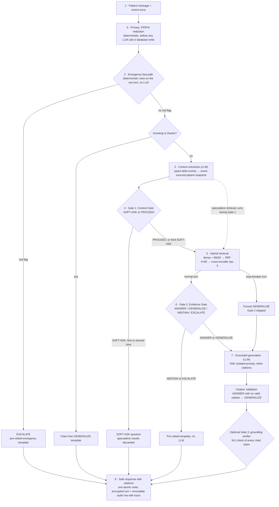

# MedBridge

**CardioGuard: An Evidence-Grounded Clinical Decision Support & Patient Consultation System for Hypertension and Cardiovascular Care**

MedBridge is a safety-first chat assistant for patients and clinicians. It answers questions about hypertension and the wider cardiovascular field from a curated set of clinical guidelines, cites the passages it used, and refuses or escalates when it is not safe to answer. It does **not** diagnose and does **not** prescribe. By default every language-model call runs on the local machine through Ollama (`LOCAL_ONLY_MODE=true`), so patient text never leaves the computer.

"CardioGuard" is the title of the report and the review presentation. The system, the code and the API are called MedBridge.

> **Medical disclaimer.** MedBridge is a B.Tech research prototype, not a medical device, and it has not been clinically validated. Its output is general information, not medical advice. In an emergency call your local emergency number (112 or 108 in India, 911 in the US). See [Medical disclaimer](#medical-disclaimer).

## Contents

- [Overview](#overview)
- [What is new: the Dual Answerability Gate](#what-is-new-the-dual-answerability-gate)
- [Architecture](#architecture)
- [Features](#features)
- [Screenshots](#screenshots)
- [Results](#results)
- [Tech stack](#tech-stack)
- [Quick start](#quick-start)
- [Repository structure](#repository-structure)
- [Testing](#testing)
- [Reproducing the evaluation](#reproducing-the-evaluation)
- [Privacy and security](#privacy-and-security)
- [Limitations](#limitations)
- [Team](#team)
- [License](#license)
- [Medical disclaimer](#medical-disclaimer)

## Overview

General-purpose chatbots fail patients in two predictable ways. They state drug doses, interactions or recommendations that no guideline supports, and they personalise advice without knowing the facts that would change it (age, kidney function, pregnancy, current medicines). MedBridge targets both failures with explicit, logged decision points rather than with prompt wording alone.

**Scope.** Cardiology centred on hypertension: blood pressure measurement and targets, hypertensive emergencies, heart failure, atrial fibrillation, coronary disease, lipids and cardiovascular risk, blood pressure in chronic kidney disease and diabetes, hypertensive disorders of pregnancy, and lifestyle prevention. Non-cardiovascular medicine and non-medical topics are out of scope.

Every message ends in exactly one of five actions:

| Action | When | Who writes the reply |
|---|---|---|
| **ANSWER** | Enough patient context and the retrieved guideline evidence supports a specific answer | Grounded generator, with inline `[n]` citations |
| **SOFT-ASK** | A personal fact that would change the safe answer is missing | Generator asks for the specific missing facts and makes no clinical claims |
| **GENERALIZE** | Evidence supports only general guidance, or the patient has already been asked twice (loop-breaker) | Grounded generator, general information only |
| **ABSTAIN** | Out of scope, or the evidence does not cover the question (unknown drug, dose the guidelines do not state, false premise that cannot be corrected from evidence) | Pre-vetted template, no LLM |
| **ESCALATE** | Red-flag symptoms or a crisis-range blood pressure | Pre-vetted emergency template, no LLM |

## What is new: the Dual Answerability Gate

Retrieval-augmented generation reduces hallucination, but it never decides *whether* it is safe to answer. MedBridge makes that decision twice, at two separate points, each logged with its rationale in an append-only audit trail:

1. **Gate 1, the Context Gate (before retrieval).** Does the system know enough about *this patient* to answer safely? It returns SOFT-ASK or PROCEED. After two consecutive SOFT-ASKs a loop-breaker forces GENERALIZE, so a patient is never trapped in a questioning loop.
2. **Gate 2, the Evidence Gate (after retrieval).** Does the *retrieved evidence* support an answer? It returns ANSWER, GENERALIZE, ABSTAIN or ESCALATE.

The two gates answer different questions. Gate 1 cannot see the evidence, and retrieving more evidence cannot supply a missing personal fact, so neither gate can stand in for the other. Both run at temperature 0.0 with seed 42 and use grammar-constrained JSON output. If a gate call fails, the specification's fallback applies (Gate 1 → PROCEED, Gate 2 → GENERALIZE), and the orchestrator never returns an error to the patient.

Layers around the gates add safety without bypassing them:

- a **deterministic emergency fast-path** that runs before any LLM call;
- **template bypass**: ABSTAIN and ESCALATE never reach the generator;
- **citation validation**: citation markers that do not map to a retrieved passage are removed, and an ANSWER left with no valid citation is downgraded to GENERALIZE;
- **XML isolation** of all patient text in every prompt, with tag-escaping against injection.

**Optional extensions** (off by default, evaluated as study variants):

- **V1, calibrated Evidence Gate** (`EVIDENCE_GATE_CALIBRATION_ENABLED`): Gate 2 votes over several deterministic orderings of the evidence and is then checked against reranker-score and entity-coverage thresholds calibrated on the development split. It sits in the same position with the same four outputs.
- **Gate 3, grounding verifier** (V2, `GROUNDING_VERIFIER_ENABLED`): after generation and before the patient sees anything, each claim sentence is checked by a local NLI cross-encoder against the passages it cites. Unsupported sentences are removed. When too many are unsupported, an ANSWER is regenerated as GENERALIZE or replaced by ABSTAIN.

Both extensions can only make a reply more conservative. Whether the gates, and these variants, actually reduce hallucination is measured in the study under [Results](#results).

## Architecture



A rendered version of the updated pipeline diagram is at [`report/figures/architecture_pipeline.png`](report/figures/architecture_pipeline.png), produced by the report's diagram scripts. The original Review-1/Review-3 drawings are kept in [`diagrams/`](diagrams/).

How the pieces map to code:

| Step | What happens | LLM? | Code |
|---|---|---|---|
| 0 Privacy | Names, phone numbers, e-mails, addresses, PIN codes, Aadhaar/PAN/SSN/MRN/insurance ids, URLs and IPs are replaced with typed placeholders; a date of birth becomes an age | no | `medbridge/privacy/redaction.py` |
| 2 Emergency fast-path | Rules for crisis BP values, chest pain, stroke signs, breathlessness, fainting and more, with negation, typo and Hinglish handling | no | `medbridge/core/emergency_classifier.py` |
| 3 Extraction and state | Facts become typed events (BP_READING, MEDICATION_ADDED, MEDICATION_STOPPED, SYMPTOM_REPORTED, DEMOGRAPHIC, LAB_RESULT); the snapshot is a fold over the events; brand names are normalised to generics | yes | `medbridge/ai/context_extractor.py`, `medbridge/state/projector.py`, `medbridge/nlp/` |
| 4 Gate 1 | Context sufficiency, loop-breaker at 2 | yes | `medbridge/ai/context_gate.py` |
| 5 Retrieval | Dense `BAAI/bge-small-en-v1.5` and sparse BM25 in Qdrant, fused with reciprocal rank fusion (k = 60), top-20 reranked to top-5 by `cross-encoder/ms-marco-MiniLM-L-6-v2` | no | `medbridge/retrieval/` |
| 6 Gate 2 | Evidence sufficiency, four outputs; optional V1 calibration | yes | `medbridge/ai/evidence_gate.py`, `medbridge/ai/evidence_calibration.py` |
| 7 Generation | Patient-friendly markdown with `[n]` citations, citation validation, optional Gate 3 | yes | `medbridge/ai/response_generator.py`, `medbridge/core/citations.py`, `medbridge/ai/grounding_verifier.py` |
| 8 Persistence | One flush per turn; encrypted message, events, snapshot and audit row with a PHI-free per-stage trace | no | `medbridge/state/turn_store.py` |

The stage methods live in `medbridge/core/orchestrator.py`. **Speculative retrieval** (`SPECULATIVE_RETRIEVAL=true`, the default) starts retrieval as soon as the extractor has produced the search query, so it overlaps with Gate 1. If Gate 1 says SOFT-ASK, the task is cancelled and its results never reach Gate 2 or the generator. Gate 1 therefore still decides whether the evidence is used, and routing is identical with the flag on or off.

## Features

**Safety pipeline**

- Five-action routing behind the Dual Answerability Gate, with every gate decision, its rationale and its source (LLM, fallback, loop-breaker, rule) stored in the immutable audit log.
- Deterministic emergency fast-path for colloquial and misspelt English, negation ("no chest pain"), informational questions ("what are the symptoms of a stroke?") and Roman-script Hindi/Indian English ("seene mein dard"). It uses no model, no network and no randomness.
- Native Ollama structured outputs (JSON schema), few-shot prompts covering false premises, invented drugs, doses the guidelines do not state, children and pregnancy; per-role models (`LLM_MODEL_GATES`, `LLM_MODEL_GENERATOR`).
- Brand-to-generic drug normalisation for 189 cardiovascular brands, 65 of them Indian (for example Telma → telmisartan), and lay-to-clinical query expansion ("water pill" → thiazide diuretic).
- Multi-turn handling: the extractor sees recent turns, and after a SOFT-ASK the gates judge the original question together with the patient's follow-up details.
- Never-throw orchestrator with the specification's fallbacks, per-session turn serialisation, and warm-up of every model at start-up so the first question is not a cold start.

**Knowledge base**

- 27 curated, hash-pinned documents from 11 organisations (AHA/ACC, ESC, ISH, WHO, KDIGO, NICE, MedlinePlus, NHLBI and others; counts from `reports/corpus_stats.json`). Each is listed in [`data/corpus_manifest.json`](data/corpus_manifest.json) with its licence and SHA-256; nothing is scraped.
- Token-aware 400-token chunks, table-aware chunking, header/footer and reference-list cleaning, incremental hash-based re-indexing. Sizes are in [Results](#results).

**Web app** (served by FastAPI at `/`, plain HTML/CSS/ES modules, no build step, no third-party JavaScript)

- ChatGPT-style layout: conversation sidebar with search, rename and delete; welcome screen with suggested prompts; auto-growing composer; light and dark themes; keyboard accessible.
- Live progress through the pipeline over server-sent events, colour-coded action badges, and an emergency card with configurable numbers.
- Citation chips that open a source drawer (guideline, organisation, year, section, page, excerpt).
- **"Why this answer?" panel**: Gate 1 decision and missing fields, the top-5 evidence with scores, the Gate 2 decision, citation validation, Gate 3 when enabled, and per-stage latency.
- Patient context card (latest BP, medicines, symptoms, labs) with **Clear my data**; BP log and trend chart with ACC/AHA category bands; manual BP entry that feeds the same event pipeline.
- Copy, regenerate, thumbs-up/down feedback, conversation export and a printable clinician summary; first-visit consent notice, permanent compact disclaimer and a "PII redacted" indicator.
- Admin dashboard at `/dashboard` (password protected): action distribution, gate statistics, latency, feedback and redacted audit entries.
- The original Streamlit UI still works as a fallback (`medbridge/frontend/`).

**API** (all session routes need the signed session token)

| Method and path | Purpose |
|---|---|
| `POST /api/sessions` | New session; returns the session token |
| `POST /api/sessions/{id}/messages` | One turn (JSON) |
| `POST /api/sessions/{id}/messages/stream` | One turn as server-sent events: `stage`, `meta`, `token`, `done` |
| `POST /api/sessions/{id}/regenerate` | Re-run the last question |
| `GET /api/sessions/{id}/history` | Messages with their explanations |
| `GET /api/sessions/{id}/context`, `POST /api/sessions/{id}/bp` | Patient snapshot and BP series; manual BP entry |
| `GET /api/sessions/{id}/summary?format=md` | Clinician summary |
| `POST /api/sessions/{id}/feedback` | Rating and optional comment |
| `DELETE /api/sessions/{id}` | Right to erasure (crypto-shredding) |
| `GET /health`, `GET /api/config/public` | Readiness (models loaded, Ollama, Qdrant points); public UI config |
| `POST /api/admin/login`, `GET /api/admin/audit`, `GET /api/metrics` | Dashboard login, redacted audit feed, latency and routing metrics |

Interactive documentation is at `/docs` while the server runs.

## Screenshots

The images below are taken from the running system against the real backend; the mock server's screenshots are never used here.

<!-- SCREENSHOTS:START -->
Not captured yet (expected under `report/screenshots/`, taken against the real backend, never the dev mock):

- `welcome.png`: Welcome screen with suggested prompts
- `answer_citations.png`: ANSWER with inline citations and the source drawer
- `soft_ask.png`: SOFT-ASK: the Context Gate asks for missing facts
- `escalate.png`: ESCALATE: deterministic emergency card
- `abstain.png`: ABSTAIN: out-of-scope question, template reply
- `why_panel.png`: "Why this answer?" panel: Gate 1, evidence, Gate 2, latency
- `bp_trend.png`: BP log and trend chart with ACC/AHA bands
- `dashboard.png`: Admin / evaluation dashboard
- `dark_mode.png`: Dark mode
<!-- SCREENSHOTS:END -->

## Results

Every number in this section is written by [`scripts/render_docs_results.py`](scripts/render_docs_results.py) from a result or measurement file, and the file is named under each table. An experiment that has not finished shows as *pending*; nothing is typed in by hand. The full analysis, with figures and error analysis, is in the project report produced by `report/build_report.py`.

<!-- RESULTS:START -->
> Generated by `scripts/render_docs_results.py` from the files named under each table. Do not edit by hand: re-run the script after new results land. *pending* means the experiment has not produced its result file yet.

### Hallucination study (MedBridge-HalluBench v1, conditions C0–C5, V1, V2)

*pending* — the hallucination study has not produced `evaluation/results/summary.json` yet, so no hallucination rates, unsafe-answer rates or p-values are reported. Reproduce with `scripts/run_study.sh` or the steps in [`evaluation/README.md`](evaluation/README.md), then re-run this script.

### Retrieval evaluation (70 labelled queries, 27-document corpus)

| Mode | recall@5 | recall@20 | mrr | ndcg@5 | Queries |
| --- | ---: | ---: | ---: | ---: | ---: |
| dense | 0.740 [0.648, 0.826] | 0.860 [0.790, 0.921] | 0.677 [0.584, 0.766] | 0.641 [0.553, 0.724] | 70 |
| sparse | 0.640 [0.538, 0.738] | 0.833 [0.755, 0.902] | 0.584 [0.488, 0.676] | 0.545 [0.451, 0.634] | 70 |
| hybrid | 0.743 [0.650, 0.826] | 0.867 [0.795, 0.929] | 0.740 [0.650, 0.825] | 0.688 [0.600, 0.771] | 70 |
| hybrid+rerank | 0.733 [0.638, 0.821] | 0.867 [0.795, 0.929] | 0.698 [0.606, 0.785] | 0.657 [0.569, 0.740] | 70 |

Mean with 95% bootstrap CI over queries. Source: `evaluation/results/retrieval/metrics.json`.

Reranker ablation (top-20 hybrid candidates → top-5):

| Reranker | recall@5 | recall@20 | mrr | ndcg@5 |
| --- | ---: | ---: | ---: | ---: |
| none (hybrid RRF k=60 only) | 0.743 [0.650, 0.826] | 0.867 [0.795, 0.929] | 0.740 [0.650, 0.825] | 0.688 [0.600, 0.771] |
| cross-encoder/ms-marco-MiniLM-L-6-v2 (default) | 0.733 [0.638, 0.821] | 0.867 [0.795, 0.929] | 0.698 [0.606, 0.785] | 0.657 [0.569, 0.740] |
| BAAI/bge-reranker-base | 0.743 [0.652, 0.826] | 0.867 [0.795, 0.929] | 0.713 [0.623, 0.799] | 0.658 [0.574, 0.738] |
| cross-encoder/ms-marco-MiniLM-L-12-v2 | 0.755 [0.662, 0.840] | 0.867 [0.795, 0.929] | 0.708 [0.619, 0.794] | 0.669 [0.582, 0.751] |
| ncbi/MedCPT-Cross-Encoder | 0.748 [0.655, 0.831] | 0.867 [0.795, 0.929] | 0.734 [0.643, 0.819] | 0.683 [0.594, 0.766] |

Computed check: the 95% CIs of every reranker overlap with RRF fusion alone on every metric. Source: `evaluation/results/retrieval/reranker_ablation/*/metrics.json`, `evaluation/results/retrieval/metrics.json`.

### Model selection (application model, condition C5, dev split)

| Model | Params | Quant | Size GB | Valid turns | Routing strict | Routing lenient | Macro-F1 | Valid JSON 1st try (worst role) | Turn p50 s | Turn p95 s |
| --- | --- | --- | ---: | ---: | ---: | ---: | ---: | ---: | ---: | ---: |
| qwen3.5:4b | 4.2B | Q4_K_M | 3.3 | 59/59 | 69.5% [56.9, 79.7] (41/59) | 78.0% [65.9, 86.6] (46/59) | 0.71 | 100.0% | 10.3 | 21.5 |
| gemma3:4b | 3.9B | Q4_K_M | 3.4 | 59/59 | 40.7% [29.1, 53.4] (24/59) | 50.8% [38.4, 63.2] (30/59) | 0.47 | 95.9% | 9.3 | 20.6 |
| qwen3:8b | 8.2B | Q4_K_M | 5.2 | 59/59 | 71.2% [58.6, 81.2] (42/59) | 84.7% [73.5, 91.8] (50/59) | 0.74 | 100.0% | 16.0 | 30.2 |

Run of 2026-10-10, split `dev`. Source: `evaluation/results/model_selection/summary.json`.

### PII/PHI redaction (span level, synthetic test sets)

| Test set | Examples (pos/neg) | Gold spans | Strict P / R / F1 | Overlap P / R / F1 | Negatives altered | Clinical values corrupted |
| --- | ---: | ---: | ---: | ---: | ---: | ---: |
| Development set (written with the detector; in-sample) | 240 (150/90) | 183 | 1.000 / 0.989 / 0.995 | 1.000 / 0.989 / 0.995 | 0 | 0 |
| Blind held-out v2 (frozen detector; primary estimate) | 237 (148/89) | 203 | 0.944 / 0.744 / 0.832 | 0.988 / 0.778 / 0.871 | 1 | 0 |
| Blind v2 after post-hoc fixes (optimistic, not independent) | 237 (148/89) | 203 | 0.975 / 0.768 / 0.860 | 0.994 / 0.783 / 0.876 | 0 | 0 |

Lowest blind-set strict recall: NAME 0.429, ADDRESS 0.556.

Generated 2026-10-09. Source: `reports/privacy_redaction_metrics.json`.

### Knowledge base

| Document type | Documents | Chunks | Pages / sections |
| --- | ---: | ---: | ---: |
| guideline | 16 | 2444 | 889 |
| review | 4 | 261 | 134 |
| patient_info | 7 | 42 | 43 |
| **total** | 27 | 2747 | 1066 |

11 organisations; 505 table chunks; chunk length median 294 tokens (max 400, 0 over 512). Per-document table: `reports/corpus_stats.md`. Source: `reports/corpus_stats.json`, `data/corpus_manifest.json`.

### Live benchmarks and operations

| Check | Result |
| --- | --- |
| Smoke test (every action path, PII, SSE, auth, erasure) | 16/16 checks passed against a live local stack on 2026-10-09 (`reports/smoke_test_latest.json`) |
| MedBridge-AQ routing benchmark (275 vignettes) | *pending* (the current `reports/medbridge_aq_benchmark_report.json` is a mock-mode routing simulator, not a result; run `python -m tests.benchmark.benchmark_runner --mode live --all`) |
| RABBITS brand↔generic robustness (189 brands) | *pending* (the current `reports/rabbits_benchmark_report.json` is mock-mode (deterministic components only); run `python -m tests.adversarial.rabbits_runner --mode live`) |
| Adversarial prompt-injection suite (live) | *pending* (`reports/adversarial_live_report.json` not generated; run `python -m tests.adversarial.adversarial_runner`) |
| Load test (1/5/10 concurrent users) | *pending* (`reports/performance/load_test.json` not generated; run `python scripts/load_test.py`) |

### Latency before vs after optimisation

Baseline measured on the received version (before any change):

| Scenario turn | Action | Cold s | Warm p50 s | Warm p95 s | n |
| --- | --- | ---: | ---: | ---: | ---: |
| S1-t1 | ESCALATE | 0.03 | 0.02 | 0.03 | 3 |
| S2-t1 | ABSTAIN | 15.75 | 5.15 | 5.16 | 3 |
| S3-t1 | SOFT-ASK | 7.55 | 7.63 | 8.01 | 3 |
| S4-t1 | SOFT-ASK | 6.71 | 7.23 | 7.39 | 3 |
| S4-t2 | ANSWER | 19.73 | 17.77 | 18.06 | 3 |
| S5-t1 | ANSWER | 37.48 | 31.12 | 52.07 | 3 |

Source: `reports/performance/before_gemma3-4b.json`.

*pending* — the 'after' latency probe has not been recorded. Run `python scripts/latency_probe.py --label after ...` then `python -m evaluation.perf`.

### Test suite

- Current: *pending* (no JUnit/coverage report under `reports/tests/` yet; see the Testing section for the command).
- Received version (`fad6fea`): 5 failed, 480 passed, 12 warnings in 98.82s (0:01:38) (`reports/baseline/pytest_baseline.txt`).
<!-- RESULTS:END -->

## Tech stack

| Layer | Technology |
|---|---|
| Language | Python 3.11/3.12 (tested on macOS arm64; target demo machine Windows 11 with an RTX 4050, 6 GB) |
| API | FastAPI, Uvicorn, Pydantic v2, server-sent events |
| LLM runtime | Ollama, local models only by default (`LOCAL_ONLY_MODE=true`). The model is set by `LLM_MODEL` in `.env`: `.env.example` uses `qwen3.5:4b`, the application model picked by the model-selection experiment for the study (also the code default in `medbridge/config.py`). Separate models for the gates and the generator are optional. Groq/OpenAI remain optional providers when local-only mode is switched off. |
| Retrieval | Qdrant (dense 384-d cosine + sparse BM25), fastembed `BAAI/bge-small-en-v1.5` and `Qdrant/bm25`, sentence-transformers cross-encoder `ms-marco-MiniLM-L-6-v2` |
| Optional Gate 3 | NLI cross-encoder `cross-encoder/nli-MiniLM2-L6-H768` |
| Database | PostgreSQL 16 (SQLAlchemy 2 async, asyncpg, Alembic), append-only rules on `clinical_events` and `audit_logs` |
| Privacy | `cryptography` (Fernet envelope encryption), HMAC-signed tokens, structlog with a PII-scrubbing processor |
| Ingestion | PyMuPDF, an HTML parser, token-aware chunker |
| Front ends | Vanilla HTML/CSS/ES modules (main UI and dashboard); Streamlit (legacy) |
| Evaluation | numpy, scipy, matplotlib, openpyxl; LLM judge (default `gemma3:12b`, a different model family) and NLI judge `cross-encoder/nli-deberta-v3-base` |
| Reports | python-docx, python-pptx, Playwright (screenshots) |
| Quality | pytest (+ asyncio, cov, timeout), Node's built-in test runner for the UI modules, ruff, mypy |
| Infrastructure | Docker Compose (PostgreSQL on 127.0.0.1:5433, Qdrant on 127.0.0.1:6333; loopback only) |

Exact versions are pinned in [`requirements.txt`](requirements.txt) and [`pyproject.toml`](pyproject.toml).

## Quick start

The full beginner guide, with separate Windows 11 and macOS sections, every `.env` variable, model sizes for a 6 GB GPU and troubleshooting, is **[HOW_TO_RUN.md](HOW_TO_RUN.md)**. The short version, from the repository root:

```bash
python -m venv .venv
# Windows: .venv\Scripts\activate      macOS/Linux: source .venv/bin/activate
pip install -r requirements.txt
python scripts/setup_env.py              # creates .env with fresh encryption/session keys and passwords
ollama pull qwen3.5:4b                   # the model named by LLM_MODEL in .env
python scripts/download_corpus.py        # two PDFs need a manual browser download, see data/README.md
python -m medbridge.cli doctor           # checks Python, Docker, Ollama, ports, models
python -m medbridge.cli up --open        # Docker services, migrations, first-run ingestion, server, browser
```

Then open <http://127.0.0.1:8000>. The dashboard is at `/dashboard` (user `admin`, password from `ADMIN_PASSWORD` in `.env`).

## Repository structure

```text
MedBridge/
├── medbridge/                 application package
│   ├── main.py                FastAPI app, lifespan warm-up, routers, web mount
│   ├── cli.py                 cross-platform launcher: doctor, up, ingest, smoke
│   ├── config.py              settings (pydantic-settings, .env)
│   ├── core/                  orchestrator (stage methods), emergency classifier, citations,
│   │                          small talk, templates, pipeline types (stages, ablation presets)
│   ├── ai/                    LLM wrapper (Ollama structured outputs), context extractor,
│   │                          Context Gate, Evidence Gate, response generator, V1 calibration,
│   │                          Gate 3 grounding verifier, prompt utilities, output schemas
│   ├── nlp/                   drug normaliser (brand → generic), query expansion, BP parser
│   ├── retrieval/             embedder, hybrid retriever (RRF k=60), cross-encoder reranker, caches
│   ├── state/                 event projector, session manager, single-flush turn store
│   ├── privacy/               redaction, encryption and crypto-shredding, tokens, auth
│   │                          dependencies, security middleware, log scrubbing, retention
│   ├── features/              BP categories and clinician summary
│   ├── api/                   routes (sessions, messages, features, admin, metrics, health,
│   │                          config), request/response schemas, error handler
│   ├── db/                    SQLAlchemy models and connection
│   ├── ingestion/             PDF/HTML parsing, chunking, indexing, manifest, stats (python -m)
│   ├── web/                   single-page app and dashboard (HTML, CSS, ES modules, node tests)
│   ├── frontend/              legacy Streamlit UI
│   └── tests/                 unit and integration tests
├── evaluation/                hallucination study: HalluBench dataset, runner, LLM and NLI
│                              judges, calibration, statistics, figures, retrieval evaluation,
│                              model selection, human-annotation sheet; results/
├── tests/                     adversarial (prompt injection, SQLi, RABBITS), benchmark
│                              (MedBridge-AQ vignettes), evaluation, privacy, scripts, data
├── scripts/                   setup_env, download_corpus, smoke_test, load_test, latency_probe,
│                              llm_sanity_check, pii_eval, run_study.sh, study_ollama.sh,
│                              render_docs_results
├── alembic/                   migrations (append-only rules, privacy/trace/feedback tables)
├── data/                      corpus_manifest.json and README (documents are downloaded, not committed)
├── reports/                   measurement outputs: corpus stats, PII metrics, smoke test,
│                              benchmarks, performance, figures/
├── report/                    build_report.py and its sources: content/ (chapters), lib/,
│                              diagrams/ (figure scripts), figures/, references/, paper/
├── diagrams/                  original architecture drawings (Review 1–3)
├── docs/                      constitution, technical specification, architecture decision log,
│                              module map, finalization plan, review checklist, demo script
├── docker-compose.yml         PostgreSQL 16 and Qdrant, bound to 127.0.0.1
├── HOW_TO_RUN.md              setup and run guide (Windows 11 and macOS)
├── CHANGELOG.md               everything changed since the received version
├── requirements.txt, pyproject.toml, alembic.ini, conftest.py, .env.example
├── .streamlit/                theme and server settings for the legacy Streamlit UI
└── README.md
```

## Testing

```bash
pytest                                   # hermetic suite; services that are down are skipped
pytest -m live                           # end-to-end tests against the live stack (opt-in)
node --test medbridge/web/tests          # UI module tests (no dependencies)
ruff check . && mypy medbridge
```

The default run excludes `live` tests. Tests marked `postgres`, `qdrant` or `ollama` are skipped automatically when that service is not reachable, and database tests use a separate `medbridge_test` database, never the development one. To produce the files the results renderer reads:

```bash
pytest --junitxml=reports/tests/junit.xml --cov --cov-report=json:reports/tests/coverage.json
```

Against a running server (see [HOW_TO_RUN.md](HOW_TO_RUN.md)):

```bash
python scripts/smoke_test.py                              # one query per action, PII, SSE, auth, erasure
python scripts/load_test.py --users 1,5,10                # p50/p95 latency and error rate
python -m tests.benchmark.benchmark_runner --mode live --all --resume     # MedBridge-AQ, 275 vignettes
python -m tests.adversarial.rabbits_runner --mode live --resume           # brand/generic consistency
python -m tests.adversarial.adversarial_runner                            # 19 injection payloads
```

Live runners refuse to write to the development database; pass `--database-url` or set `EVAL_DATABASE_URL`.

## Reproducing the evaluation

The hallucination study compares six conditions on **MedBridge-HalluBench v1** (247 synthetic items, 298 turns, six categories; 49 development items for calibration only, 198 test items for every reported number):

| Condition | Retrieval | Gate 1 | Gate 2 | Generator prompt |
|---|---|---|---|---|
| C0 Direct LLM | – | – | – | direct (no evidence) |
| C1 Vanilla RAG | ✓ | – | – | plain RAG prompt |
| C2 RAG + prompt-only safety | ✓ | – | – | plain RAG prompt + written safety rules |
| C3 Context Gate only | ✓ | ✓ | – | production prompt |
| C4 Evidence Gate only | ✓ | – | ✓ | production prompt |
| C5 MedBridge | ✓ | ✓ | ✓ | production prompt |
| V1 / V2 / V12 | C5 plus the calibrated Evidence Gate, Gate 3, or both | | | |

Hallucination is judged twice: by an LLM judge from a different model family, which splits each reply into atomic claims and labels them SUPPORTED, UNSUPPORTED or CONTRADICTED, and by a deterministic NLI cross-encoder on the same claims. Agreement is reported as Cohen's κ, and a 50-item sheet is provided for human labelling. Statistics: Wilson intervals, bootstrap intervals for claim ratios, exact McNemar tests paired by item and turn with Holm correction, Cochran's Q, risk differences and odds ratios. The calibration order is enforced in code:

```bash
scripts/run_study.sh                     # C5 dev → judge dev → calibrate → all conditions on test → judge → analyze
# or step by step: see evaluation/README.md
python -m evaluation.retrieval_eval      # retrieval metrics (70 labelled queries)
python -m evaluation.model_selection --models qwen3:8b,qwen3.5:4b,gemma3:4b --split dev
python -m evaluation.human_annotation --export      # then --score once the sheet is filled
python -m evaluation.perf                # before/after latency table from reports/performance/
python scripts/pii_eval.py               # PII redaction metrics
python scripts/render_docs_results.py    # refresh the numbers in this README and the docs
```

Identical LLM requests are memoised (the cache file is tied to the exact model digests), so paired conditions differ only in pipeline structure. Every run writes a manifest with the git commit, dataset hash, model digests, hardware and seeds. Turns that fell back to a degraded path are excluded from the headline numbers and reported separately.

## Privacy and security

- **Redaction first.** Patient text is redacted before any LLM call, retrieval, log line or database write. Only the deterministic emergency classifier sees the raw text, and it neither stores nor logs it.
- **Local only.** With `LOCAL_ONLY_MODE=true` (the default) the LLM wrapper talks only to a loopback Ollama server and refuses remote or cloud-offloaded models.
- **Encryption at rest.** Each session has its own data key, wrapped by a master key from `.env`. Message text, audit text and rationales, event payloads, the snapshot and feedback comments are encrypted. Actions, timings and a PHI-free trace stay readable for metrics.
- **Right to erasure by crypto-shredding.** `DELETE /api/sessions/{id}` destroys the session key and deletes the mutable rows. The append-only `clinical_events` and `audit_logs` rows are never updated or deleted, but their ciphertext can no longer be read. An inactivity retention job (`DATA_RETENTION_DAYS`) uses the same path.
- **Access control.** Signed, expiring session tokens instead of bare session ids; a separately authenticated admin dashboard that shows only redacted previews.
- **Web hardening.** Strict Content-Security-Policy (`script-src 'self'`), no third-party scripts, an escape-first markdown renderer, rate and request-size limits, CORS limited to configured origins, and services bound to 127.0.0.1.
- **Logs.** A structlog processor scrubs PII from every log event, and SQL errors never include bound values.

Design notes are in [`medbridge/privacy/README.md`](medbridge/privacy/README.md), and the decisions are recorded in [`docs/architecture_decision_log.md`](docs/architecture_decision_log.md). The report discusses the design against India's DPDP Act 2023 and HIPAA principles.

## Limitations

- **Study results first.** Until `evaluation/results/summary.json` exists, no claim about hallucination reduction is made; the results section shows *pending*. The benchmark is synthetic and was drafted by a single author with AI assistance and no clinician review. The human-annotation sheet still has to be labelled by the team.
- **Small local models make routing errors.** The application runs on a 4–8B model on a laptop GPU, and its routing is far from perfect (see the model-selection table). A typical LLM turn makes four model calls and takes several seconds to tens of seconds on local hardware.
- **Streaming is a replay.** The generator returns validated JSON, so stage events stream live but the answer text is replayed word by word after the turn completes.
- **Rule-based emergency detection.** It is deterministic and errs towards escalating. Side-effect questions that name a red flag ("can beta blockers cause shortness of breath?") escalate, and spelled-out numbers ("two hundred over one twenty") or a bare "SOB" are not recognised. Roman-script Hindi is covered, but other Indian languages are not.
- **Rule-based PII redaction.** Structured identifiers carry over well to the blind test set, but names without a cue ("Rahul and I…") and some address formats are missed (see the redaction table). A named-entity model would close part of this gap at the cost of a new dependency.
- **Corpus gaps.** Heart failure (2 documents) and coronary disease (3 documents) are thin (`reports/corpus_stats.json`). Several wanted guidelines (ESH 2023, ESC heart failure, ESC atrial fibrillation, ESC/EAS lipids, ISSHP) could not be downloaded by script. The ESC 2024 licence reserves text-and-data-mining rights, and the team must decide whether to keep it (see `data/README.md`).
- **Single node.** The rate limiter and the per-session turn lock are in-process, so the server is meant to run as one worker. Session tokens are stateless, so erasure does not revoke a token (the session simply returns 410). Master-key rotation is not implemented, and losing the master key makes stored sessions unreadable.
- **Gate 3 needs calibration.** In early integration runs the uncalibrated verifier rejected most claims, so it stays off by default until its thresholds are calibrated on the development split.
- **Demo machine.** Development and measurements were done on an Apple M5. The Windows 11 / RTX 4050 path (CUDA reranker, Edge rendering) has to be checked on the demo laptop as described in HOW_TO_RUN.md.

## Team

| | |
|---|---|
| Students | Vijay Aravindh S. (23BAI1160), Mohammad Farhan Rashid (23BAI1529) |
| Guide | Dr. Maheswari S. |
| Programme | B.Tech final-year capstone, Year 4, Semester VII, [TO BE FILLED: department, university] |
| Individual contributions | [TO BE FILLED: contribution split, also stated in the report appendix] |
| Publication | Paper draft and venue research in [`report/paper/`](report/paper/); venue [TO BE FILLED: chosen venue and submission proof] |

## License

Copyright © 2026 the authors. All rights reserved by the authors. [TO BE FILLED: license]

The clinical guideline documents are not part of this repository. Each one is downloaded from its publisher and stays under the publisher's licence, which is recorded per document in [`data/corpus_manifest.json`](data/corpus_manifest.json). Model weights are subject to their own licences.

## Medical disclaimer

MedBridge is educational research software. It gives general, guideline-based information and deliberately refuses or escalates when it cannot answer safely, but it can still be wrong, incomplete or out of date. It does not diagnose, prescribe or replace a doctor, and it is not a certified medical device. Do not start, stop or change any medicine because of its output; talk to a qualified clinician. If you have chest pain, trouble breathing, signs of a stroke (face drooping, arm weakness, speech difficulty), fainting, or a blood pressure of 180/120 mmHg or higher with symptoms, call your emergency number now (112 or 108 in India, 911 in the US) or go to the nearest emergency department.
